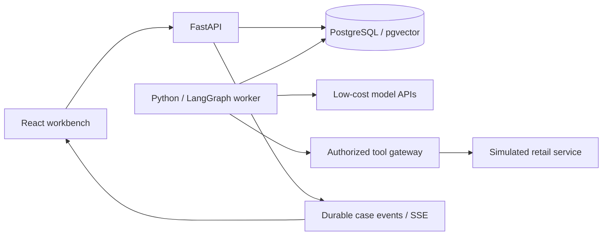

# PolicyOps

An evidence-grounded AI operations workbench for investigating customer-service cases, inspecting policy citations, and approving simulated business actions.

**Status: development foundation (locked environments, CI, publication safeguards). Application features and benchmark results are not implemented yet.**

## Intended architecture

React and TypeScript will provide a case queue, evidence viewer, agent activity stream, and approval controls. Core evaluation comparisons will use CLI reports; an interactive evaluation explorer is planned as an extension. A Python/FastAPI service and durable worker will share domain services; PostgreSQL will store cases, approvals, execution records, and policy vectors. LangGraph will coordinate bounded investigations and human review. Business mutations will pass through an authorization and idempotency gateway to a separate retail simulator service.



## Evaluation approach

The planned evaluation uses pinned public [Sierra τ-bench resources](https://github.com/sierra-research/tau2-bench), with separate reporting for upstream task outcomes, retrieval experiments, and application safety tests. Database checks and invariant tests will be distinguished from model-based judgments. Adapted tasks and changed simulator or judge settings will be identified explicitly.

Retrieval experiments will compare full-policy context, PostgreSQL full-text search, dense vectors, hybrid rank fusion, and bounded reranking. Recovery and authorization tests will check duplicate writes, stale approvals, tenant isolation, and interrupted runs. No accuracy, performance, or cost improvements are claimed at this stage.

## Development setup

Prerequisites: Git, a Python 3.10+ interpreter to run the helper scripts, [uv](https://docs.astral.sh/uv/) 0.13.x (CI uses 0.13.7) and Node.js 26.13.0 (`.nvmrc`). uv installs the project's CPython 3.12 itself.

### Process-local paths

Every tool run goes through `scripts/devenv.py`. It requires `POLICYOPS_TEMP_DIR`, an absolute directory **outside** the checkout, and points temporary files, uv/npm/ruff/mypy caches, Python installs, both virtual environments, coverage, web build output and the per-user application data directory (`LOCALAPPDATA` on Windows, `XDG_DATA_HOME` on Linux, where Vitest keeps its API token file) beneath it for that command only. It also disables Python bytecode, `.env` auto-loading by upstream libraries (`PYTHON_DOTENV_DISABLED=1`) and litellm's import-time pricing download. No global settings are changed. Test suites refuse to run without this setup. On macOS, Vitest uses `~/Library/Application Support` regardless of these variables, so this containment is unsupported and unverified on macOS; it covers Windows and Linux.

The helper scripts and Git hooks below run without the wrapper, so set the temporary root and the process temp variables in that shell first (current session only):

```powershell
# PowerShell
$env:POLICYOPS_TEMP_DIR = 'D:\path\outside\checkout\policyops-tmp'
$env:TEMP = "$env:POLICYOPS_TEMP_DIR\tmp"; $env:TMP = $env:TEMP; $env:PYTHONDONTWRITEBYTECODE = '1'
New-Item -ItemType Directory -Force $env:TEMP | Out-Null
```

```sh
# POSIX shells
export POLICYOPS_TEMP_DIR=/path/outside/checkout/policyops-tmp
export TEMP="$POLICYOPS_TEMP_DIR/tmp" TMP="$POLICYOPS_TEMP_DIR/tmp" TMPDIR="$POLICYOPS_TEMP_DIR/tmp" PYTHONDONTWRITEBYTECODE=1
mkdir -p "$TMPDIR"
```

Installed web dependencies are the one directory kept in the checkout: `apps/web/node_modules/`, which Node module resolution needs inside the web project (ignored by Git and Docker). It holds only what `npm ci` installs; caches and scratch files that tools generate are routed to `POLICYOPS_TEMP_DIR` like everything else, and new files appearing below `node_modules/` fail the artifact check.

### Publication safeguards (before any commit)

```powershell
git config --local core.hooksPath .githooks
python -B scripts/gitleaks_gate.py install   # checksum-verified gitleaks 8.30.1 into $POLICYOPS_TEMP_DIR/tools
```

The pre-commit hook runs `scripts/check_publication.py` (index path/content guard) and then `scripts/gitleaks_gate.py staged`; the pre-push hook runs the guard over reachable history and then a gitleaks scan of every local ref. The guard runs first and must pass before the scanner runs; a failure of either step blocks the commit or push, and so does a missing or unverified scanner. Scans also require a valid `POLICYOPS_TEMP_DIR`, even when `POLICYOPS_GITLEAKS` names the scanner, and keep their scratch files and the scanner's TEMP/TMP under `$POLICYOPS_TEMP_DIR/tmp`, whatever the shell's TEMP/TMP say. The gate verifies the scanner binary against pinned SHA-256 values, uses the repository `.gitleaks.toml` (built-in rules plus a project rule, no allowlist), ignores inline `gitleaks:allow` comments, refuses to run when a root `.gitleaksignore` exists, and prints only redacted locations. Hooks find the scanner through `POLICYOPS_GITLEAKS`, then `$POLICYOPS_TEMP_DIR/tools/gitleaks-8.30.1/`, then `PATH`; commit and push from a shell set up as in [Process-local paths](#process-local-paths). These are safeguards against accidental publication, not a complete secret-detection system. New clones must enable hooks themselves.

### Python: application and evaluator

Two separate uv projects with separate locks:

| Project | Lock | Contents |
|---|---|---|
| Application (repository root workspace) | `uv.lock` | `packages/policyops` (FastAPI, SQLAlchemy/Alembic, psycopg, LangGraph) and `packages/policyops_contracts` |
| Evaluator / retail-simulator wrapper | `evals/uv.lock` | `tau2[knowledge]` at commit `19f13ea3f5fba8b4c4d272d1353590f29dc53062`, transport/persistence/migration libraries and `policyops_contracts` |

`policyops_contracts` depends only on Pydantic, so the evaluator never installs or imports the application package. Both locks only admit distributions published before the `exclude-newer` cutoff in their `pyproject.toml`.

```powershell
python -B scripts/devenv.py uv sync --frozen
python -B scripts/devenv.py uv run --frozen ruff check .
python -B scripts/devenv.py uv run --frozen mypy
python -B scripts/devenv.py uv run --frozen pytest

python -B scripts/devenv.py uv sync --project evals --frozen
cd evals
python -B ../scripts/devenv.py uv run --frozen mypy
python -B ../scripts/devenv.py uv run --frozen pytest
```

The wrapper resolves the uv project the way uv does (`--directory`/`UV_WORKING_DIR` first, then `--project`/`UV_PROJECT` relative to it, otherwise the working directory), selects the matching application or evaluator virtual environment and pins `UV_PROJECT` to that project for the command and its children, so the two locks never install into the same environment. It refuses, before running anything, forms it cannot read reliably: uv options other than `--directory`/`--project` before the subcommand, `--project`/`--directory` after `run` or `tool` (write `uv --project evals run ...`, and put a child command's own options after `--`), `--active`, repeated options, and other uv projects inside the checkout.

### Web

```powershell
cd apps/web
python -B ../../scripts/devenv.py npm ci
python -B ../../scripts/devenv.py npm run lint
python -B ../../scripts/devenv.py npm run typecheck
python -B ../../scripts/devenv.py npm test
python -B ../../scripts/devenv.py npm run build    # output: $POLICYOPS_TEMP_DIR/build/web
```

From the repository root, `python -B -m unittest discover -s tests/web -v` runs `npm test` with a fresh temporary root and checks that Vitest's token file is created under it, not in the caller's user-data directory or `node_modules/` (existence only; the token is never read). It needs the installed web dependencies, so pytest does not collect it; the web CI job runs it.

### Continuous integration

`.github/workflows/ci.yml` runs on Ubuntu and Windows without secrets or model API keys: publication guard plus gitleaks over full history, both Python environments (frozen sync, lint, strict type checks, tests) and the web checks. Its temporary root is `$RUNNER_TEMP/policyops`, outside the checkout, and each job finishes with `scripts/check_repo_artifacts.py`, which lists every untracked or ignored path individually (including inside ignored directories) and fails on files left in the checkout. The web job records the tree `npm ci` installed (failing if the install wrote anywhere else) and afterwards fails on any new path, including new files under `node_modules/`. Actions are pinned to commit SHAs. Container image pins (PostgreSQL 17 with pgvector, Dex, Caddy) are recorded by digest in `infra/images.json`; Compose and Dockerfiles are not implemented yet.

Not implemented yet: `policyops data fetch`, `policyops eval`, `docker compose up` and any provider or paid evaluation command. `.env.example` records proposed configuration only; real credentials belong in an ignored `.env` file or a deployment secret store.

## Data and licensing

No upstream dataset or implementation has been copied into this repository; the evaluator environment installs tau2-bench as a pinned dependency. The original [τ-bench license](https://github.com/sierra-research/tau-bench/blob/main/LICENSE) and the [τ²-bench repository license](https://github.com/sierra-research/tau2-bench/blob/19f13ea3f5fba8b4c4d272d1353590f29dc53062/LICENSE) are MIT. Any later import must retain applicable notices, record its revision and hashes, and check for additional file-level terms. PolicyOps's own distribution license will be selected before publication.
