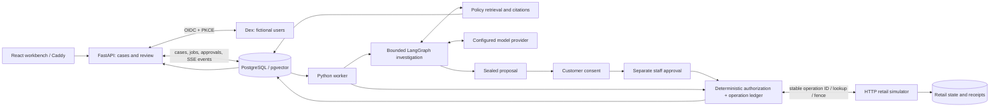
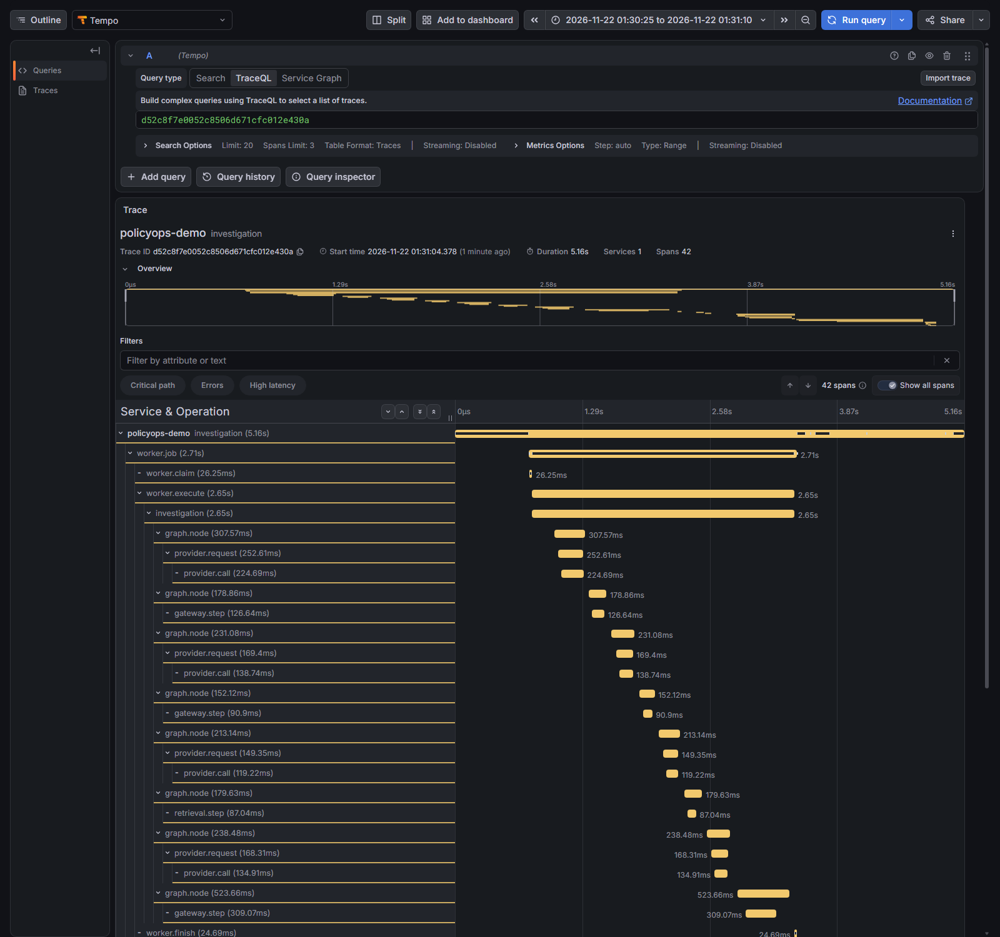
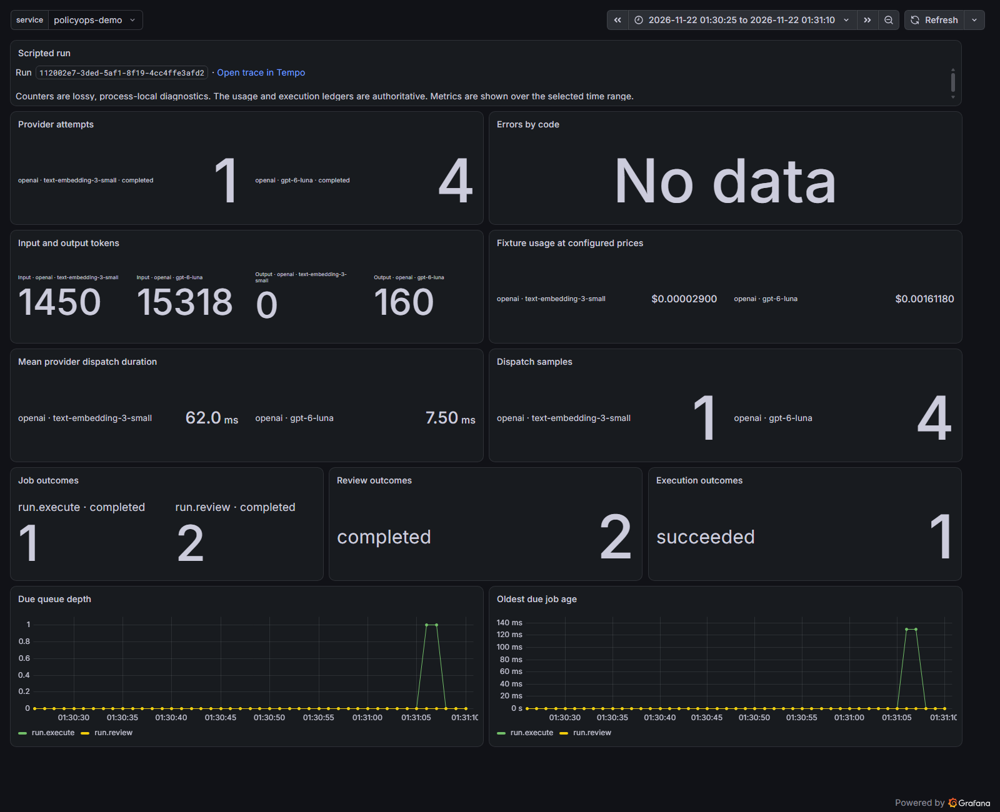

# PolicyOps

[](https://github.com/XiaoyunYin/policyops/actions/workflows/ci.yml)

PolicyOps is an AI operations workbench for investigating fictional retail support cases,
reviewing cited proposals, and approving simulated order changes.
It separates model suggestions from deterministic authorization, then uses durable operation
IDs and receipts to reconcile writes whose responses are lost.

**Status.** Live demo at [52-11-210-0.sslip.io](https://52-11-210-0.sslip.io) · verified live 2026-11-15; observed reachable 2026-11-21.
The demo starts from a seeded proposal with fictional data. It runs on one host with
restricted demo roles, a nightly reset and no SLA.
[Sign-in and demo steps](docs/deployment.md#public-credentials-and-fixture-reset) ·
[What failed and what changed](#what-failed-and-what-changed).

## Results at a glance

| Study | Status | Result |
|---|---|---|
| [Agent model comparison (E03)](docs/evaluation.md#e03-model-comparison) | `descriptive` | Luna strict pass^1 0.700 vs Haiku 0.750. Difference −0.050 [−0.135, +0.035], with 44% lower settled all-actor cost. The non-inferiority gate did not pass. |
| [Scenario baseline](docs/evaluation.md#scenario-evaluation-and-tool-contract-profile) | negative | Development diagnostic: 4/192 exact first proposals (2.1% [0.000, 0.047]) and 0/48 unsafe attempts before the gateway. Invalid replies stopped 30/32 delivered-cancellation and missing-reason slots before a decision. |
| [Tool-contract profile](docs/evaluation.md#held-out-result) | positive | Held-out exact first proposals rose to 171/192 vs 3/192 before the gateway (Δ +0.875 [0.828, 0.922]). The safety guard passed on the point estimate, with 2/48 unsafe attempts vs 0/48, both on ambiguous multi-order cases. |
| [Prompt caching](docs/evaluation.md#prompt-caching-study) | positive | Luna settled cost per scheduled dev slot fell to 0.254× [0.243, 0.265] with caching. The outcome guardrail narrowly passed, no latency gain was shown, and savings relied on traffic within the 30-minute TTL. |
| [Recovery / execution ledger (E04)](docs/evaluation.md#e04-operation-ledger-versus-naive-retry) | positive | Across 100 paired faults, 83 completed once and 17 were fenced without effect, with zero duplicates. Naive retry misreported all 20 committed writes with lost responses. |
| [Gateway vs prompt-only (E05)](docs/evaluation.md#e05-gateway-versus-prompt-only) | positive | Final live sample: 0/48 vs 2/48 attack effects, and 0/12 vs 6/12 false blocks. Acceptance covers the tested authority rules. |
| [MCP parity (O01)](docs/evaluation.md#mcp-parity-o01) | positive | 167/167 read-only calls matched the direct gateway path, with zero unauthorized disclosures or false denials. Warm p50/p95 overhead 14.5/39.9 ms, cold start about 3.1 s. Luna client smoke 2/2 for $0.0003. |
| [Browser and recovery drills](docs/evaluation.md#recovery-and-e07-correctness) | positive | 2/2 Playwright flows passed, along with kill-after-commit recovery by receipt lookup and a stopped-writer restore into a second database on the same PostgreSQL cluster. |
| [LLM-judge calibration](docs/evaluation.md#llm-judge-calibration) | negative | Agreement with human labels was κ 0.398 [0.358, 0.438], below the registered gate. Judged RAG metrics remain `descriptive`. |
| [BM25 development result](docs/evaluation.md#bm25-development-result) | `descriptive` | BM25 vs OR-based full-text search: R@5 0.458 vs 0.114, a paired gain of +0.344 [+0.284, +0.404] on 500 development questions (R@10 0.548 vs 0.168). |
| [Sealed RAG retrieval](docs/evaluation.md#sealed-rag-retrieval) | `inconclusive` | On human-labelled MultiDoc2Dial, RRF − dense R@5 was −0.019 [−0.038, +0.0005]. Dense was numerically ahead. |
| [Sealed RAG answers](docs/evaluation.md#sealed-rag-answers) | `inconclusive` | One arm used a local cross-encoder (CE). Non-confirmatory gold-citation differences: CE − RRF +0.059 [+0.033, +0.085], adjusted lower bound +0.029. CE − Luna rerank +0.005 [−0.022, +0.032], at p95 6.6 s vs 8.1 s. CE reranks on local CPU at $0 provider cost. |
| [Model cascade](docs/evaluation.md#model-cascade) | negative | No Luna→Haiku threshold qualified on dev. Plain Luna had a gold-citation rate of 0.378 at $0.000202 per question vs Haiku's 0.394 at $0.000312. The cascades scored 0.352 / 0.356 / 0.402 at $0.000205 / $0.000205 / $0.000444 in known cost per question. |
| [Reranker fine-tuning](docs/evaluation.md#reranker-fine-tuning) | negative | Neither of the two pre-declared recipes beat the base cross-encoder on internal validation. |
| [Bedrock adapter](docs/evaluation.md#bedrock-adapter) | Offline-verified only | The adapter signs its own SigV4 requests through the bounded transport, using static credentials and a US inference profile. Live access was declined for this new AWS account for now. |

Brackets show 95% confidence intervals. E03 used the minimal agent with the full retail
policy. The [evaluation report](docs/evaluation.md) gives denominators, failure codes, spend
and reproduction commands.

CI checks request bytes and grader outcomes on eight scripted retail development scenarios. [Scenario CI gate](docs/evaluation.md#scripted-scenario-ci-gate).

## What failed and what changed

- Scenario tapes showed that authenticated lookup hid the user ID required by the next tool, the wire schema omitted the order ID pattern, validation notices lacked field detail, and `all_terms` often missed the relevant policy clause.
- The first tool-contract candidate failed the development safety guard after choosing the first matching order. The single prompt revision required reading every order on the profile when the customer omitted the order ID and proposing a write only for a unique match. [Ambiguous order selection RCA](docs/rca-ambiguous-order-selection.md).
- The revised profile still made 2/16 unsafe attempts on held-out ambiguous multi-order cases. Staff approval is designed to catch these proposals before execution. Scenario grading took place before the gateway.
- Prompt-caching savings relied on prefix reuse across investigations. The study showed no latency gain, and the lower confidence bound for exact first proposals was close to the guardrail margin.
- On development data, AND-based lexical search rarely matched conversational queries, tight answer and rerank limits caused slot failures, and downstream errors zeroed retrieval scores. The study added BM25, revised the limits and preserved completed ranking metrics.
- The judge missed its calibration gate, so the sealed RAG claims used human relevance labels.
- No cascade threshold met the development gate. In an unplanned observation on development data, without an interval, plain Luna was cheaper than each cascade on known cost and had comparable citation rates.
- Neither fine-tuning recipe beat the base cross-encoder, which stayed in the sealed study.
- One unresolved provider bill ($0.00108 held) among 1,302 CE-arm slots made both reranking claims `inconclusive` before the margin test. The accounting rule worked as registered and yielded no positive claim.
- Live deployment surfaced five defects, all fixed: shared Lightsail names, bootstrap user-data and SSH setup, merged Compose networking, a missing PostgreSQL trust root, and CPU burst exhaustion from heavy health checks.

## Workflow

An operator opens a case. A configured, bounded investigation agent reads business facts
and policy evidence, then presents a cited proposal. The customer must consent to its exact
terms, and a separate authorized staff member must approve the sealed version. The execution
service rechecks authority, sends the write to the retail simulator, and records a receipt
or an explicit unresolved outcome.



The graph and provider composition are implemented and tested separately from the default
Compose demo. The browser flow uses staff-entered simulated customer consent; it is not
evidence of real customer consent or a model-driven browser investigation.
See [runtime composition](docs/architecture.md#investigation-graph-and-checkpoints) and
[the browser acceptance scope](docs/operations.md#real-browser-workbench-acceptance).

## Local observability profile

Run `python -B scripts/observability_demo.py` in the prepared evaluator environment to open a
fresh investigation in Grafana. The worker, retrieval, approval and simulated execution paths
run against local PostgreSQL. Provider replies and token usage come from fixtures, with zero
paid calls and no provider credentials. The host-side driver sends telemetry to the local stack
and checks for both the trace and metrics before printing its run ID and dashboard link.

This development profile runs only on loopback and is excluded from the public demo host.
Its dashboard shows diagnostic observations for the scripted run. The harness owns the root
span. Jobs in separate processes can produce separate traces, correlated by run ID.
[Setup and teardown](docs/operations.md#local-observability-profile).





*One local scripted cancellation, captured 2026-11-22: 42 spans in one trace across investigation, review and simulated execution; four fixture-backed chat calls and one embedding call; one simulator receipt. Provider replies and usage came from fixtures. No paid call was made. The local image used about 1.2 GiB of its 2 GiB limit.*

## Engineering decisions

| Decision | Trade-off and rejected alternative | Evidence |
|---|---|---|
| The model proposes; deterministic services authorize | More explicit rules and refusal paths; prompt-only policy enforcement cannot close expiry/revocation races | [Gateway](docs/architecture.md#policy-and-tool-gateway), [E05](docs/evaluation.md#e05-gateway-versus-prompt-only) |
| Consent and staff approval bind immutable versions and digests | Changes require a fresh decision; a generic approval flag cannot bind arguments, evidence, terms and expiry | [Review contracts](docs/architecture.md#proposal-review), [race tests](tests/integration/test_proposal_decisions.py) |
| Stable operation IDs, a ledger and reconciliation | Ambiguous writes may remain unknown or be fenced without effect; checkpoint replay or blind retry cannot establish a remote outcome | [Execution](docs/architecture.md#approved-execution-and-reconciliation), [E04](docs/evaluation.md#e04-operation-ledger-versus-naive-retry) |
| Forced RLS with separate migration/runtime roles | More grants and transaction scope management; application filters alone leave query mistakes exposed | [Database roles](docs/database.md#roles), [runtime-role tests](tests/integration/test_app_tenancy.py) |
| Reserve worst-case cost and retain unknown bills | Conservative holds reduce availability; estimating a missing bill as zero would permit unaccounted spending | [Budget ledger](docs/architecture.md#model-configuration-and-usage-budgets), [accounting tests](tests/integration/test_budget_ledger.py) |
| Prespecified dev studies, registered holdout, strict pass^k | Errors remain failures in headline metrics; dropping errored trials or changing gates after results would bias selection | [Evaluation method](docs/evaluation.md#method), [statistics](evals/src/policyops_evals/studies/statistics.py) |
| PostgreSQL jobs and a tenant-bound JSON checkpointer | Fewer services, explicit fencing and serializer maintenance; Redis/Celery and unrestricted object checkpoints add dependencies or authority | [Runtime](docs/architecture.md#investigation-graph-and-checkpoints), [checkpoint tests](tests/integration/test_checkpoints.py) |

## Stack

- **Backend:** Python 3.12, FastAPI, Pydantic, SQLAlchemy, Alembic, psycopg;
  LangGraph investigation with a custom PostgreSQL checkpointer.
- **Persistence:** PostgreSQL 17, pgvector, full-text search, immutable evidence versions,
  leased jobs, transactional outbox, execution and usage ledgers.
- **Web:** React, strict TypeScript, Vite, React Router, React Aria Components;
  generated OpenAPI types and fetch-based SSE replay.
- **Identity and operations:** OIDC authorization code + PKCE, server-side sessions,
  Dex, Caddy, Docker Compose, opt-in OpenTelemetry and allowlisted JSON logging.
- **Evaluation:** separately locked τ²-bench runtime, bounded OpenAI/Anthropic SDK adapters,
  pytest, Vitest and Playwright. Default tests use fake providers and block network access.

Exact versions are in [the app lock](uv.lock), [the evaluator lock](evals/uv.lock),
[the web lock](apps/web/package-lock.json) and [image pins](infra/images.json).

## Quickstart

Use Git, a helper Python interpreter (3.10+), uv 0.13.x (verified with 0.13.7),
Node 26.13.0 and Docker with Linux amd64 containers and Compose 2.24+.
Dependency installation, tokenizer provisioning and image builds need network access;
the checks below run offline after provisioning. Commands start at the repository root.

Set a process-local scratch directory outside the checkout. On Linux use equivalent
exports, set `TMPDIR` too, and use `venvs/app/bin/python`.

```powershell
$env:POLICYOPS_TEMP_DIR = 'D:\path\outside\checkout\policyops-tmp'
$env:TEMP = "$env:POLICYOPS_TEMP_DIR/tmp"
$env:TMP = $env:TEMP
$env:PYTHONDONTWRITEBYTECODE = '1'
New-Item -ItemType Directory -Force $env:TEMP | Out-Null
python -B scripts/devenv.py uv sync --frozen
python -B scripts/devenv.py uv sync --project evals --frozen
python -B scripts/fetch_tokenizer_vocab.py
Push-Location apps/web
python -B ../../scripts/devenv.py npm ci
Pop-Location
```

Start the local stack with fresh external secrets:

```powershell
$env:POLICYOPS_PYTHON = "$env:POLICYOPS_TEMP_DIR/venvs/app/Scripts/python.exe"
$env:COMPOSE_PROJECT_NAME = 'policyops-demo'
$env:POLICYOPS_RUN_ID = 'demo-choose-a-fresh-unique-id'
$env:POLICYOPS_SECRETS_DIR = "$env:POLICYOPS_TEMP_DIR/compose/$env:POLICYOPS_RUN_ID/secrets"
$env:POLICYOPS_HTTP_PORT = '8080'
& $env:POLICYOPS_PYTHON -B scripts/compose_secrets.py
python -B scripts/check_build_context.py --context .
docker compose build
docker compose up -d
docker compose ps --all
```

Open **http://127.0.0.1:8080**. Fictional analyst Alice, reviewer Bob and auditor Carol
use the generated password files; do not copy them into logs. Startup runs separate app
and retail migrations. Follow [operations](docs/operations.md#start-and-stop) for sign-in
fixtures, the [browser scenario](docs/operations.md#real-browser-workbench-acceptance),
stopping, reuse of secrets and safe disposal of a selected demo volume.
A fresh run returns `runtime.unconfigured` until a model runtime is explicitly composed.

Run offline checks with installed dependencies and cached tokenizer/scanner assets:

```powershell
python -B scripts/devenv.py uv run --offline --frozen ruff check .
python -B scripts/devenv.py uv run --offline --frozen mypy
python -B scripts/devenv.py uv run --offline --frozen pytest
Push-Location evals
python -B ../scripts/devenv.py uv run --offline --frozen mypy
python -B ../scripts/devenv.py uv run --offline --frozen pytest
Pop-Location
Push-Location apps/web
python -B ../../scripts/devenv.py npm --offline run lint
python -B ../../scripts/devenv.py npm --offline run typecheck
python -B ../../scripts/devenv.py npm --offline test
Pop-Location
python -B scripts/check_publication.py
```

PostgreSQL integration and real-browser suites are separate and require local services.
[Development and harness reference](docs/operations.md#development-setup) includes both
environments, generated API contracts, test guards, publication hooks and CI definitions.
No paid evaluation or provider call is part of these default commands.

## Live demo / Deploy

[Open the live demo](https://52-11-210-0.sslip.io). The seeded proposal exercises
simulated customer consent, separate staff approval and simulator execution. Public
demo roles are restricted to the fictional tenant, and the nightly reset discards
demo activity. The host has no model provider keys.

Release `3609714` passed all 28 live verifier checks, including HTTPS and Dex login.
The schema-compatible A/B/A drill passed 28/28 at each step, with a docs-only B release.
PostgreSQL clients enforce `verify-full` with an explicit trust root. The public profile
runs lightweight health checks every 30 seconds and ships precompiled Python bytecode.
The deployed revision is older than main. Lightsail costs about $12/month with a $20
budget alert. [Deployment runbook](docs/deployment.md).

GitHub Actions runs offline gates on Ubuntu and Windows and PostgreSQL/Dex integration
on Ubuntu. The default checks make no model calls.

## Repository map

| Path | Purpose |
|---|---|
| [`packages/policyops/`](packages/policyops/) | API, domain rules, services, gateway, runtime, providers, persistence and telemetry |
| [`packages/policyops_contracts/`](packages/policyops_contracts/) | Strict wire schemas, tool catalog, policy traceability and exact money |
| [`apps/web/`](apps/web/) | Case queue, evidence/activity views, approval inbox and outcome cards |
| [`evals/`](evals/) | Pinned benchmark adapter, metadata manifests, study configs, reports and retail simulator |
| [`tests/`](tests/) | Offline, PostgreSQL, authorization, recovery and tooling regressions |
| [`infra/`](infra/) | Compose images, runtime composition, migrations/seed wiring, Dex and Caddy |
| [`scripts/`](scripts/) | Local environments, safety studies, scans and deployment/recovery drivers |
| [`.github/workflows/`](.github/workflows/) | Ubuntu/Windows offline gates and explicit PostgreSQL job |

## Limits and remaining work

- The live demo is a single host with no SLA. It uses fictional data and simulated
  commerce mutations.
- E03 does not show Luna quality-equivalent to Haiku. Its reference errors and held bill
  remain reported; costs are local ledger calculations, not reconciled provider invoices.
- Banking trajectory retrieval (E01) is outside this release: ingestion, search, reranking
  and offline metric machinery exist, but its study controller/evaluator contract and
  quality results do not. Retail E03 uses full policy context.
- A reordered stable prefix and Anthropic caching remain unmeasured. ANN/HNSW scaling, graph-versus-loop
  quality, an evaluation explorer and a production collector/dashboard stack are also
  outside the current evidence. The supervised retail pilot and the RCA follow-up actions
  are proposed.
- The Bedrock adapter is verified offline only. Live access was declined for this new
  AWS account for now. [Bedrock adapter](docs/evaluation.md#bedrock-adapter).
- No hard end-to-end deadline guarantee: synchronous SQL, in-flight remote calls and
  connection shutdown have documented limits. No billing-evidence outbox exists.
- Citations verify historical source identity and exact quotes, not entailment or truth.
  The recovery drills cover one host and a stopped-writer same-cluster logical restore,
  not host loss, PITR or every crash window. Broader screen-reader review remains open.
- Known dependency advisories and scan limitations are recorded in
  [security](docs/security.md#residual-risks-and-explicit-exclusions).

## Documentation and license

[Architecture and API contracts](docs/architecture.md) ·
[Evaluation and results](docs/evaluation.md) ·
[Local operations and development](docs/operations.md) ·
[Database and restore](docs/database.md) ·
[Authentication](docs/authentication.md) ·
[Security and tests](docs/security.md) ·
[Retail pilot scope](docs/pilot-scope.md) ·
[Ambiguous order selection RCA](docs/rca-ambiguous-order-selection.md) ·
[Data provenance](docs/data-provenance.md).

PolicyOps is [MIT licensed](LICENSE). Bulk benchmark data, task payloads and document text
are fetched outside the checkout, not committed. The simulator image includes the audited
retail fixture and upstream license; the root upstream MIT grant does not establish every
data file's provenance. See [third-party notices](THIRD_PARTY_NOTICES.md).
