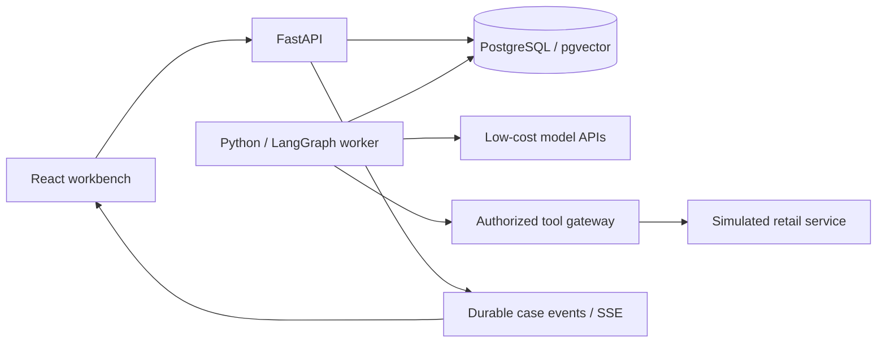

# PolicyOps

An evidence-grounded AI operations workbench for investigating customer-service cases, inspecting policy citations, and approving simulated business actions.

**Status: locked development environments and publication safeguards, reviewed public-data acquisition, typed retail/consent/approval contracts, PostgreSQL persistence, an OIDC/session authentication API, the case/message API, and run start/cancel with leased, fenced background jobs, a durable outbox and replayable event streaming (with the OpenAPI document and generated TypeScript types), a model registry with dated prices, an exact cost calculator and a durable usage-budget ledger, and provider adapters for the OpenAI Responses and Anthropic Messages APIs (one user-approved, capped live smoke verified the OpenAI text, tool and structured-output paths; the Anthropic inference requests returned HTTP 400 with the cause not yet established; no agent workflow calls the adapters), and an evals-owned retail-simulator HTTP service with durable per-case state, versions and receipts, its own migration chain and roles, and a typed client (tested against the pinned retail fixture), and a deterministic policy and tool gateway (scoped lookups, reads and computed non-actionable write previews, and an execution precheck that loads persisted authority records by reference; no write is dispatched by it, and no persisted decision store or operation ledger exists yet) are implemented. No investigation runtime is installed: starting a run answers 503 until T21, and only a deterministic test executor exercises the worker. Persisted proposals and decisions, the execution workflow and the UI remain pending. No model-quality or performance results are claimed.**

## Intended architecture

React and TypeScript will provide a case queue, evidence viewer, agent activity stream, and approval controls. Core evaluation comparisons will use CLI reports; an interactive evaluation explorer is planned as an extension. A Python/FastAPI service and durable worker will share domain services; PostgreSQL will store cases, approvals, execution records, and policy vectors. LangGraph will coordinate bounded investigations and human review. Business mutations will pass through an authorization and idempotency gateway to a separate retail simulator service.



## Evaluation approach

The planned evaluation uses pinned public [Sierra τ-bench resources](https://github.com/sierra-research/tau2-bench), with separate reporting for upstream task outcomes, retrieval experiments, and application safety tests. Database checks and invariant tests will be distinguished from model-based judgments. Adapted tasks and changed simulator or judge settings will be identified explicitly.

Retrieval experiments will compare full-policy context, PostgreSQL full-text search, dense vectors, hybrid rank fusion, and bounded reranking. Recovery and authorization tests will check duplicate writes, stale approvals, tenant isolation, and interrupted runs. No accuracy, performance, or cost improvements are claimed at this stage.

## Contracts and domain rules

`packages/policyops_contracts` defines the typed, strict wire contracts: retail tool calls and state snapshots, exact minor-unit money, displayed effects and their server-rendered confirmation text, action proposals bound by one SHA-256 digest, case messages with explicit provenance, customer consent, separate staff approval, agent steps, run events, errors, demo seeds and the clause-anchored pinned retail policy rule table. `packages/policyops/.../domain` holds the deterministic rules that use them. [docs/architecture.md](docs/architecture.md) explains the scope, policy interpretations, consent and approval binding, and the dev calibration allowlist. Business-policy authorization, approval workflow APIs and execution remain later work; authentication and workspace-role dependencies are described below.

## Authentication

OIDC authorization code flow with PKCE through the backend, durable browser-bound login state, opaque server-side sessions (digest-only storage, absolute and idle expiry, rotation, revocation), synchronizer CSRF tokens with exact origin checks, and a reusable `require_action` dependency that reads the principal's current workspace membership on every request. Local identity is the pinned Dex with fictional users (`infra/dex/config.yaml.tmpl`). [docs/authentication.md](docs/authentication.md) describes the flow, validation rules, cookie and deployment settings, tests and limits.

## Case and message API

Workspace-scoped routes to list, create and read cases, change their status and post staff notes or operator-entered customer turns. Every write takes an `Idempotency-Key`, replays its original response on retry and commits the change, its audit row and the stored response together; status changes and messages also need the case's strong `If-Match` version. The queue uses typed cursors over the immutable creation order, and request bodies are bounded to 64 KiB as received. [docs/architecture.md](docs/architecture.md#case-and-message-api) describes the routes, idempotency, preconditions, pagination, limits and the OpenAPI/TypeScript contract.

## Runs and event streaming

Starting a run (idempotent, bound to the case version, at most one active run per case) creates the run, its first event and outbox intent, a queued (not yet leased) execute job and an audit row in one transaction; a worker leases the job when it claims it, and cancelling fences out any in-flight work. Workers discover jobs through a narrow role, claim them with `SKIP LOCKED` under the database clock, and fence every write with a stable claim ID, the run generation and the current lease; exhausted, expired or unsupported work is dead-lettered with typed codes. Events are replayed over server-sent events from a durable high-water mark, with reconnect, explicit retention gaps and a session/membership check on every poll. No investigation runtime is installed yet, so starting a run answers 503; T21 adds it. [docs/architecture.md](docs/architecture.md#runs-leased-jobs-and-event-streaming) has the details and limits.

## Model configuration and usage budgets

`policyops.budget` holds the allowed models and a dated, primary-source price snapshot (no fallback model). It
prices usage exactly, at the whole-prompt tier, with cache reads and writes per lifetime. It also holds the
server-owned actor configuration and caps: per request, per run, per scenario, per invocation, per study and per
non-run operation.

A durable ledger in PostgreSQL reserves the worst case in every applicable scope atomically. It grants at most one
dispatch per attempt, keeps unknown results held, settles at the original price revision, and blocks a scope after
any overrun or contract violation. The typed offline preflight bounds an evaluation study and never authorizes
paid execution. [docs/architecture.md](docs/architecture.md#model-configuration-and-usage-budgets) has the rules and
limits.

## Provider adapters

`policyops.providers` prepares one exact, fingerprinted request per physical attempt. It counts it once through the
provider's count endpoint, dispatches only with the ledger's single grant, and sends it through the official SDKs
pinned exactly (`openai` 3.40.0, `anthropic` 2.3.0). SDK retries are disabled, timeouts are explicit, redirects and
ambient environment settings are refused, and a transport lets only the bound bytes out. Usage settles exactly when
it is known and priced, stays held when it is not, and a contract violation blocks further progress. Structured
results are validated locally against the full domain schema. The test suites run offline against a scripted
transport. One user-approved live smoke, capped and with no retries, verified the OpenAI text, required-tool and
structured-output paths. Its Anthropic count requests were accepted, but the three inference requests returned
HTTP 400; the cause is not yet established, so Anthropic inference remains unverified. Full paired-provider
acceptance is open, and no agent workflow calls the adapters yet. See
[docs/architecture.md](docs/architecture.md#provider-adapters).

## Retail simulator

`evals/.../retail_sim` wraps the pinned upstream retail tools (no fork) in an internal HTTP service. Each case gets
its own isolated copy of the audited fixture, bound once to its customer. A write runs the upstream tool on an
in-memory candidate, rebuilds the change it *actually* made from the before and after states, checks every amount as
exact money, and compares that with the approved expected effect. Only an exact match commits, atomically with the
new versions and an immutable receipt; anything else leaves one terminal record and no other change. Stable
operation IDs replay, a fence makes an absent operation definitively not executed, every request carries a
short-lived signed context with a single-use nonce, and the `retail` schema has its own roles and row-level
security. `policyops.adapters.retail_client` is the application's typed client: it never retries a write and treats
a lost or foreign response as unknown. Commands:

```sh
python -B scripts/devenv.py uv --directory evals run --frozen policyops-retail-simulator --help
```

See [docs/architecture.md](docs/architecture.md#retail-simulator) and
[docs/database.md](docs/database.md#retail-schema).

## Policy and tool gateway

`packages/policyops/.../gateway` is the only path from an agent step to the retail service. The scope comes from
the persisted run and case, and the retail client must be bound to it before any request. The closed parser refuses
unknown tools and extra fields.

**Lookups and reads.** A lookup authenticates only the case's bound customer, durably and first write wins. A read
must return the requested resource and exactly its version.

**Writes.** A write gathers the customer, the order and the replacement items. All of them must come from one case
version, with at most three complete collections. The deterministic rules then evaluate them, and the result is
only a computed, non-actionable preview.

**Execution precheck.** The precheck re-validates persisted proposal, consent and approval records by reference.
It re-evaluates current facts, so approval never overrides the policy. It checks the approver's current role and
the proposal's evidence after the reads, and the expiry last. It returns the exact mutation request and its
authorization deadline, and dispatches nothing.

**Defaults that refuse until later tasks.** Until T18 and T19 exist:
- there is no decision store, so the precheck refuses;
- the operation history is incomplete, so once-per-order tools escalate.

[docs/policy-coverage.json](docs/policy-coverage.json) maps every policy rule to its executed cases. See
[docs/architecture.md](docs/architecture.md#policy-and-tool-gateway).

## Application database

`packages/policyops/.../persistence` holds the PostgreSQL schema, roles and migrations: a superuser bootstrap creates five restricted roles (migrator, app runtime, auth runtime, evaluation runtime, worker discovery) and the database; an eight-revision Alembic chain run as the migrator creates the `identity`, `app`, `evaluation` and empty `checkpoints` schemas with tenant-composite foreign keys, forced row-level security on a transaction-local workspace scope, append-only grants, a proposal-immutability trigger, digest-bound presentation/consent/decision records, unique idempotency keys and exact `NUMERIC` USD checks. Revision `0003` adds durable login requests and session idle/CSRF state; `0004` adds the case API's request-idempotency ledger and queue index; `0005` adds run fencing, event high-water/retention fields, job claims and the discovery role's grants; `0006` adds the usage-budget ledger; `0007` binds request identity, counts and contract blocks to it; `0008` adds durable per-run customer lookup authentication. Typed repositories and a synthetic importer use them. [docs/database.md](docs/database.md) describes the roles, invariants, upgrade/downgrade/restore semantics and limits. Authentication uses these records; business workflow authorization remains later work.

## Development setup

Prerequisites: Git, a Python 3.10+ interpreter to run the helper scripts, [uv](https://docs.astral.sh/uv/) 0.13.x (CI uses 0.13.7) and Node.js 26.13.0 (`.nvmrc`). uv installs the project's CPython 3.12 itself.

### Process-local paths

Every tool run goes through `scripts/devenv.py`. It requires `POLICYOPS_TEMP_DIR`, an absolute directory **outside** the checkout, and points temporary files, uv/npm/ruff/mypy caches, Python installs, both virtual environments, coverage, web build output and the per-user application data directory (`LOCALAPPDATA` on Windows, `XDG_DATA_HOME` on Linux, where Vitest keeps its API token file) beneath it for that command only. It also disables Python bytecode, `.env` auto-loading by upstream libraries (`PYTHON_DOTENV_DISABLED=1`) and litellm's import-time pricing download. No global settings are changed. Test suites refuse to run without this setup. On macOS, Vitest uses `~/Library/Application Support` regardless of these variables, so this containment is unsupported and unverified on macOS; it covers Windows and Linux.

The helper scripts and Git hooks below run without the wrapper, so set the temporary root and the process temp variables in that shell first (current session only):

```powershell
# PowerShell
$env:POLICYOPS_TEMP_DIR = 'D:\path\outside\checkout\policyops-tmp'
$env:TEMP = "$env:POLICYOPS_TEMP_DIR\tmp"; $env:TMP = $env:TEMP; $env:PYTHONDONTWRITEBYTECODE = '1'
New-Item -ItemType Directory -Force $env:TEMP | Out-Null
```

```sh
# POSIX shells
export POLICYOPS_TEMP_DIR=/path/outside/checkout/policyops-tmp
export TEMP="$POLICYOPS_TEMP_DIR/tmp" TMP="$POLICYOPS_TEMP_DIR/tmp" TMPDIR="$POLICYOPS_TEMP_DIR/tmp" PYTHONDONTWRITEBYTECODE=1
mkdir -p "$TMPDIR"
```

Installed web dependencies are the one directory kept in the checkout: `apps/web/node_modules/`, which Node module resolution needs inside the web project (ignored by Git and Docker). It holds only what `npm ci` installs; caches and scratch files that tools generate are routed to `POLICYOPS_TEMP_DIR` like everything else, and new files appearing below `node_modules/` fail the artifact check.

### Publication safeguards (before any commit)

```powershell
git config --local core.hooksPath .githooks
python -B scripts/gitleaks_gate.py install   # checksum-verified gitleaks 8.30.1 into $POLICYOPS_TEMP_DIR/tools
```

The pre-commit hook runs `scripts/check_publication.py` (index path/content guard) and then `scripts/gitleaks_gate.py staged`; the pre-push hook runs the guard over reachable history and then a gitleaks scan of every local ref. The guard runs first and must pass before the scanner runs; a failure of either step blocks the commit or push, and so does a missing or unverified scanner. Scans also require a valid `POLICYOPS_TEMP_DIR`, even when `POLICYOPS_GITLEAKS` names the scanner, and keep their scratch files and the scanner's TEMP/TMP under `$POLICYOPS_TEMP_DIR/tmp`, whatever the shell's TEMP/TMP say. The gate verifies the scanner binary against pinned SHA-256 values, uses the repository `.gitleaks.toml` (built-in rules plus a project rule, no allowlist), ignores inline `gitleaks:allow` comments, refuses to run when a root `.gitleaksignore` exists, and prints only redacted locations. Hooks find the scanner through `POLICYOPS_GITLEAKS`, then `$POLICYOPS_TEMP_DIR/tools/gitleaks-8.30.1/`, then `PATH`; commit and push from a shell set up as in [Process-local paths](#process-local-paths). These are safeguards against accidental publication, not a complete secret-detection system. New clones must enable hooks themselves.

### Python: application and evaluator

Two separate uv projects with separate locks:

| Project | Lock | Contents |
|---|---|---|
| Application (repository root workspace) | `uv.lock` | `packages/policyops` (FastAPI, SQLAlchemy/Alembic, psycopg, LangGraph) and `packages/policyops_contracts` |
| Evaluator / retail-simulator wrapper | `evals/uv.lock` | `tau2[knowledge]` at commit `19f13ea3f5fba8b4c4d272d1353590f29dc53062`, transport/persistence/migration libraries and `policyops_contracts` |

`policyops_contracts` depends only on Pydantic, so the evaluator never installs or imports the application package. Both locks only admit distributions published before the `exclude-newer` cutoff in their `pyproject.toml`.

```powershell
python -B scripts/devenv.py uv sync --frozen
python -B scripts/devenv.py uv run --frozen ruff check .
python -B scripts/devenv.py uv run --frozen mypy
python -B scripts/devenv.py uv run --frozen pytest

python -B scripts/devenv.py uv sync --project evals --frozen
cd evals
python -B ../scripts/devenv.py uv run --frozen mypy
python -B ../scripts/devenv.py uv run --frozen pytest
```

The wrapper resolves the uv project the way uv does (`--directory`/`UV_WORKING_DIR` first, then `--project`/`UV_PROJECT` relative to it, otherwise the working directory), selects the matching application or evaluator virtual environment and pins `UV_PROJECT` to that project for the command and its children, so the two locks never install into the same environment. It refuses, before running anything, forms it cannot read reliably: uv options other than `--directory`/`--project` before the subcommand, `--project`/`--directory` after `run` or `tool` (write `uv --project evals run ...`, and put a child command's own options after `--`), `--active`, repeated options, and other uv projects inside the checkout.

### Web

```powershell
cd apps/web
python -B ../../scripts/devenv.py npm ci
python -B ../../scripts/devenv.py npm run lint
python -B ../../scripts/devenv.py npm run typecheck
python -B ../../scripts/devenv.py npm test
python -B ../../scripts/devenv.py npm run build    # output: $POLICYOPS_TEMP_DIR/build/web
```

The API contract comes from the backend: `python -B scripts/devenv.py uv run --frozen python -B -m policyops.api.openapi --out packages/policyops/openapi/v1.json` exports the OpenAPI document (a unit test fails when it is stale), and `python -B scripts/devenv.py python -B scripts/api_types.py --write` (or `--check`) regenerates `apps/web/src/api/schema.d.ts` with the isolated, exactly locked generator in `scripts/api-types`. The generator is installed from its lock into a fresh directory under the temporary root on every run, so it needs registry access for that install; the generation itself runs with closed proxies.

From the repository root, `python -B -m unittest discover -s tests/web -v` runs `npm test` with a fresh temporary root and checks that Vitest's token file is created under it, not in the caller's user-data directory or `node_modules/` (existence only; the token is never read). It needs the installed web dependencies, so pytest does not collect it; the web CI job runs it.

### Test harness

Both pytest suites load `tests/support/policyops_testing` as a plugin. It provides:

- **Network guard.** Installed for the whole session, it refuses outbound TCP/UDP connections, DNS lookups (`getaddrinfo` accepts IP literals only) and unregistered loopback endpoints. It raises `NetworkBlocked`, which is not an `OSError`, so retry code cannot treat it as a transient error. A test reaches a local server only by registering its exact loopback IP and port with the `allow_endpoint` fixture; registrations are revoked at teardown.
  - Limitations: the guard patches Python's `socket` module in the test process only. Subprocesses, C extensions (libpq, so psycopg checks its targets with `require_registered`), `ctypes` and socket functions captured before the plugin loads are not intercepted.
  - It is not physical network isolation. Run under a network-less container for that.
- **Web guard.** In the web tests, `src/test/setup.ts` replaces `fetch`, `XMLHttpRequest`, `WebSocket` and `EventSource` with blockers as soon as it is evaluated, before any test file or application module is imported, and again before each test. Every attempt is recorded and fails the test, even if the code under test swallows the error. A test may `installFake()` one global; fakes are reset after each test. Node modules imported directly by a test are not covered.
- **Fake provider.** A scripted, deterministic model stand-in. Each expected request must match exactly; only a matching request advances the script. An unexpected or extra request fails, and teardown fails too, even if the code under test caught the error; so does a leftover script. Timeouts are raised, never retried, and carry the scripted billed usage (or `None` when unknown).
- **Clocks and seeds.** `policyops_contracts.clock` provides UTC-only `FixedClock` and `SteppingClock`. Every test reseeds `random` from `POLICYOPS_TEST_SEED`, default `20261104`, which the report header shows.
- **Evidence recorder.** Artifacts stay inside a root below `POLICYOPS_TEMP_DIR`. The root is checked before anything is created, and its directory chain is re-checked before every later operation, so a root replaced by a link or another directory is refused. Absolute paths, traversal, symlinks and junctions are refused, and files are written through fresh, exclusively created temporary files.
  - Command output is redacted before it is written, including the values of secret-named flags in that command's argv and of secret-named variables in an explicitly supplied `env`.
  - Every non-zero exit, timeout or failure to start adds a failure record.
  - Other artifacts that contain a known secret or credential pattern are refused rather than altered.
  - The manifest may not replace a recorded or existing file.
  - Metrics must be exact values traced to recorded artifacts.
  - Artifacts are re-hashed before the manifest (schema `evidence-manifest`) is written. The recorder refuses to write a manifest that still contains secret-like content.
  - Redaction covers registered values, argv/env-derived values and common key/token/password formats.
  - Explicitly known secrets must be at least 6 characters. Shorter ones are refused before anything runs or is written, because masking them would destroy ordinary output.
  - Unknown formats can pass. Pytest's own terminal output is not redacted.

PostgreSQL tests (and the real-issuer tests, which also need the pinned Dex image) carry the `postgres` marker and are deselected by default. They cover the harness fixture and the application database: bootstrap, migrations (empty, populated previous revision, failed revision, refused/allowed lossy downgrade), dump/restore into a separate database, the full role/privilege matrix, RLS and pool scope reset, tenant-composite keys, immutability, binding records and optimistic/dedupe races. The run tests cover two-worker contention, a killed worker process and its reclaim, lease expiry and expired-but-unreclaimed writes, the database clock read after a lock wait, cancellation races, dead letters, outbox rollback/coalescing/starvation, the 0005 upgrade/refusals/downgrade and SSE over a real loopback server (positions, gaps, revocation mid-stream, lifetime). The budget ledger tests hold the contended scope row while competing reservations, dispatch grants, releases and settlements queue on it. They also cover overruns, cancellation, provider request ID reuse, tenancy, the eval study chain, role and grant refusals, and the 0006 upgrade and guarded downgrade. The case API tests drive the served app over HTTP: roles, tenancy and foreign IDs, same-key and separate-key races, original-response replay (also after a lost response), stale versions, revocation while waiting for a lock, rollback, body bounds, cursors, every response checked against the OpenAPI document and real bodies compiled against the generated TypeScript (this one needs Node and `npm ci` in `apps/web`). The restart self-test uses a separate owned server and leaves the shared test server untouched; it verifies a small fixture data set. Representative application shutdown and recovery validation remains pending. The PostgreSQL tests need Docker with Linux containers and the pinned image, which they never pull themselves:

```powershell
docker pull pgvector/pgvector@sha256:01215e09bd4bd582d20230e025b6c971deeeffee49ceef1aae167e839cb62a7e
docker pull ghcr.io/dexidp/dex@sha256:65b72ca0f4b0bf6d4ada84ec21da8851782563404ac7b8f926923d27ceced9ab
python -B scripts/devenv.py uv run --frozen pytest -m postgres
```

Each session starts its own container: labelled, read-only root filesystem, Docker logging off, TCP only, published on an ephemeral `127.0.0.1` port (never 5432). It does not touch any other container or port. The image's data volume is bind-mounted from a unique directory under `$POLICYOPS_TEMP_DIR/tests/postgres/`, so no anonymous volume is created; PGDATA and the server log live there.

The fixture creates two roles, a migrator and a runtime role, both without superuser, BYPASSRLS, CREATEDB or CREATEROLE. The tests check row-level security as the actual runtime role on a harness table; this is not application tenant isolation.

The persisted server log omits client ERROR/WARNING messages and failed statement text, while keeping startup, shutdown and FATAL lines. Do not put secrets in `RAISE LOG` text or connection startup options.

Tests connect only through `connect()`, which fixes host, hostaddr, port, user and libpq startup options to the owned server and accepts only its two database names. Ambient `PG*` variables such as `PGOPTIONS` therefore cannot change server logging on the bootstrap connection. `try_password()` exists for wrong-password tests. No other libpq parameter can be passed through.

Application-database tests register extra roles and databases explicitly (`register_role`, `register_database`; validated identifiers only, never connection strings) before `connect()` accepts them. `dump_and_restore` runs `pg_dump`/`pg_restore` inside the owned container as the superuser; the password reaches a 0600 pgpass file through stdin (never argv or logs), the file is removed afterwards and the dump stays in the bind mount under `$POLICYOPS_TEMP_DIR`.

Teardown removes the container by ID after checking its labels and fails if it is still there. The data and log directories are kept for diagnosis. On Linux, PGDATA belongs to the image's `postgres` user, so the invoking user may be unable to delete it.

### Continuous integration

`.github/workflows/ci.yml` runs on Ubuntu and Windows without secrets or model API keys: publication guard plus gitleaks over full history, both Python environments (frozen sync, lint, strict type checks, tests) and the web checks. An Ubuntu-only job pulls the pinned PostgreSQL and Dex images by digest, runs `pytest -m postgres` (database, authentication and real-issuer tests) and then fails if an owned container or a new Docker volume remains; Windows runners have no Linux container engine. Its temporary root is `$RUNNER_TEMP/policyops`, outside the checkout, and each job finishes with `scripts/check_repo_artifacts.py`, which lists every untracked or ignored path individually (including inside ignored directories) and fails on files left in the checkout. The web job records the tree `npm ci` installed (failing if the install wrote anywhere else) and afterwards fails on any new path, including new files under `node_modules/`; it also checks the generated API types against the OpenAPI document. The PostgreSQL job installs the web dependencies the same way, for the TypeScript response check. Actions are pinned to commit SHAs. Container image pins (PostgreSQL 17 with pgvector, Dex, Caddy) are recorded by digest in `infra/images.json`; Compose and Dockerfiles are not implemented yet.

Not implemented yet: `policyops eval`, `docker compose up` and any provider or paid evaluation command. Public-data acquisition is the evaluator-owned `policyops-evals data` command (next section), not part of the application. `.env.example` lists implemented authentication variables alongside proposed provider/deployment settings. Authentication does not automatically load `.env`; export its configured values explicitly or supply them through a deployment secret store. The CI workflow defines checks; hosted CI has not been exercised.

## Data and licensing

No upstream dataset or implementation has been copied into this repository. The evaluator environment installs tau2-bench at commit `19f13ea3f5fba8b4c4d272d1353590f29dc53062` as a pinned dependency, and `policyops-evals data fetch` acquires that commit's public data into a directory outside the checkout:

```powershell
python -B scripts/devenv.py uv --project evals run --frozen policyops-evals data fetch --dest D:\path\outside\tau2-fetch     # network
python -B scripts/devenv.py uv --project evals run --frozen policyops-evals data verify --acquired D:\path\outside\tau2-fetch # offline
python -B scripts/devenv.py uv --project evals run --frozen policyops-evals data check-manifests                              # offline, no data
```

The fetch re-hashes every Git object, and verification rebuilds the pinned root tree from the actual file bytes. `evals/manifests/tau2-19f13ea3/` holds only reviewed metadata: hashes, task IDs, counts, the 64-dev/50-held-out retail split (held-out = upstream `retail_50`), the grouped 39/58 banking-knowledge split, a per-file rights audit and tokenizer-specific corpus counts. [docs/data-provenance.md](docs/data-provenance.md) documents the method, results and remaining uncertainty. Held-out tasks are refused for demos, smoke runs and tuning. Hidden task fields never cross the evaluator's runtime projection. The τ²-bench repository license is MIT ([notice](THIRD_PARTY_NOTICES.md)), as is the original [τ-bench license](https://github.com/sierra-research/tau-bench/blob/main/LICENSE). That root license is the only explicit grant found; it does not establish the provenance of every data file. PolicyOps's own distribution license will be selected before publication.

`scripts/devenv.py` also enables Python UTF-8 mode, because upstream reads JSON without an explicit encoding. It passes `core.autocrlf=false` to child Git processes, because a CRLF checkout of tau2 changes upstream's code fingerprints. The evaluator therefore has its own versioned uv cache and virtual environment (`cache/uv-evals-raw-v1`, `venvs/evals-raw-v1`); the application keeps `cache/uv` and `venvs/app`. Older evaluator cache and environment directories are left untouched and unused.
