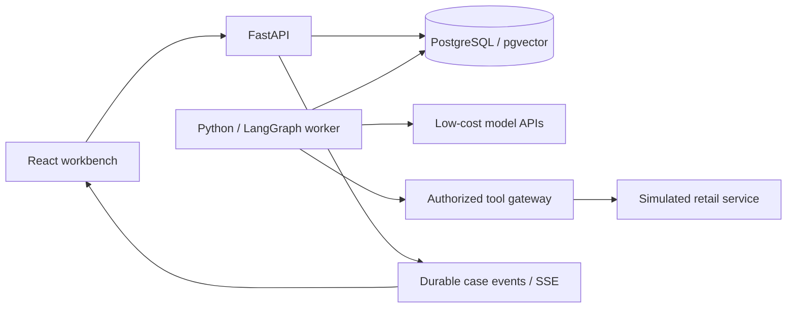

# PolicyOps

An evidence-grounded AI operations workbench for investigating customer-service cases, inspecting policy citations, and approving simulated business actions.

**Status.** Implemented and tested locally; nothing here has run in hosted CI, and no model-quality, retrieval or performance results are claimed.

Implemented:
- Locked development environments, publication safeguards and reviewed public-data acquisition.
- Typed retail, consent and approval contracts, and the deterministic policy and tool gateway: scoped lookups, reads and computed, non-actionable write previews, and an execution precheck that loads persisted authority records by reference. It dispatches no write, and no persisted decision store or operation ledger exists yet.
- PostgreSQL persistence (eleven revisions), an OIDC/session authentication API, the case/message API, and run start/cancel with leased, fenced background jobs, a durable outbox and replayable event streaming, with the OpenAPI document and generated TypeScript types.
- A model registry with dated prices, an exact cost calculator and a durable usage-budget ledger.
- Provider adapters for the OpenAI Responses and Anthropic Messages APIs. User-approved, capped live smokes on 2026-11-05 verified the text, tool and structured-output paths for both providers. The Anthropic paths were verified only after the request stopped sending the optional `speed` field named by a diagnostic of the earlier HTTP 400 refusals, which remain recorded. No agent workflow calls the adapters.
- An evals-owned retail-simulator HTTP service with durable per-case state, versions and receipts, its own migration chain and roles, and a typed client tested against the pinned retail fixture.
- T12 so far: an accounted and cached embedding foundation (local cl100k counting, one ledger-granted request per frozen batch, exact evidence, a per-workspace vector cache) with one bounded live compatibility smoke on 2026-11-05 (below), and a corpus-ingestion command: section-aware parser, source manifest, atomic generation publish, revision `0010`, and an operator CLI whose default is a read-only plan.
- T13 (internal, programmatic): a retrieval step over one corpus's current generation with four modes: the retail-domain full-policy control, PostgreSQL full-text search, exact pgvector cosine and document-level reciprocal-rank fusion. It delivers bounded, formatted evidence under a whole-string cl100k budget, charges its query embedding to the run's shared budget, and records an immutable per-step intent and a trace with historical replay. It has been exercised on synthetic fixtures with scripted transport, and verified locally on Windows with Docker Desktop (lint, type checks, the application default and PostgreSQL suites, the evaluator default suite, the scanner and static checks); hosted CI has not been run.
- T14 (internal, programmatic): an optional, off-by-default rerank stage over a step's first fused documents, deterministic validation of a model's cited answer against the run's own stored traces, and atomic citation recording with historical reconciliation, with per-invocation work reporting that keeps ledger grants apart from physical counts. It has been exercised on synthetic fixtures with scripted transports and local PostgreSQL.
- T15a (internal, offline): the machinery for a later retrieval evaluation, with no study run. It has typed planning contracts (a proposed manifest, a separate selection decision, trajectory records and a report), a pure evaluator-side metric engine, dev-only label access, an authoritative read-only export of stored retrieval steps into records, and two named local query-plan diagnostics. The metrics keep the delivered evidence set, the candidate set and the full ranking apart, and report strict, observed-progress and complete-case variants with paired, task-weighted uncertainty. It has been exercised on synthetic fixtures and local PostgreSQL; no quality, coverage, cost or performance result exists. See [docs/architecture.md](docs/architecture.md#retrieval-evaluation-machinery-t15a).
- T20 (internal, programmatic): a minimal, bounded, half-duplex agent baseline that owns one private conversation and talks to explicitly injected model, tool and optional read-only knowledge ports. The retail domain runs with the full policy in the prompt; a read-only knowledge-search interface exists but its Retriever-backed adapter is T15b. Invalid model replies leave only fixed notices, a tool outcome stays unknown until a validated matching result arrives, and cancellation and late replies are terminal. It builds no client and makes no count or provider request when constructed. It has been exercised with scripted ports and transports over synthetic data, including the real SDK and budget ledger on local PostgreSQL (multi-turn history, cancellation of an in-flight call, a shared budget and late replies), and nothing calls it: it is not the investigation graph, and starting a run still answers 503. No quality, performance, cost or grounded-answer result is claimed. See [docs/architecture.md](docs/architecture.md#minimal-agent-baseline-t20).

Not built yet:
- Any API, worker or agent-graph caller of the embedding, ingestion, retrieval, rerank or citation code (the calling service must supply the authorization of the run, case and corpus); claim-support (entailment) checking; retrieval-quality results on real queries; ANN or HNSW indexes; the UI.
- The retrieval evaluation itself (T15b): genuine development trajectories, a study controller, the visible-query sidecar, arm selection, frozen gates and any result. It depends on the read-only knowledge tool and the simulator bridge (T20, T29) and on a separate recorded approval for paid work.
- An investigation runtime: starting a run answers 503 until T21 (the graph, checkpoints, HTTP and worker wiring, and the UI), and only a deterministic test executor exercises the worker. The T20 baseline is not wired to it. The benchmark harness and real-query scores are T29 and later.
- Persisted proposals and decisions, the execution workflow and the UI.

## Intended architecture

React and TypeScript will provide a case queue, evidence viewer, agent activity stream, and approval controls. Core evaluation comparisons will use CLI reports; an interactive evaluation explorer is planned as an extension. A Python/FastAPI service and durable worker will share domain services; PostgreSQL will store cases, approvals, execution records, and policy vectors. LangGraph will coordinate bounded investigations and human review. Business mutations will pass through an authorization and idempotency gateway to a separate retail simulator service.



## Evaluation approach

The planned evaluation uses pinned public [Sierra τ-bench resources](https://github.com/sierra-research/tau2-bench), with separate reporting for upstream task outcomes, retrieval experiments, and application safety tests. Database checks and invariant tests will be distinguished from model-based judgments. Adapted tasks and changed simulator or judge settings will be identified explicitly.

Retrieval experiments will compare full-policy context, PostgreSQL full-text search, dense vectors, hybrid rank fusion, and bounded reranking. Recovery and authorization tests will check duplicate writes, stale approvals, tenant isolation, and interrupted runs. The offline machinery for these comparisons exists (see T15a above) but no comparison has been run. No accuracy, performance, or cost improvements are claimed at this stage.

## Contracts and domain rules

`packages/policyops_contracts` defines the typed, strict wire contracts: retail tool calls and state snapshots, exact minor-unit money, displayed effects and their server-rendered confirmation text, action proposals bound by one SHA-256 digest, case messages with explicit provenance, customer consent, separate staff approval, agent steps, run events, errors, demo seeds and the clause-anchored pinned retail policy rule table. `packages/policyops/.../domain` holds the deterministic rules that use them. [docs/architecture.md](docs/architecture.md) explains the scope, policy interpretations, consent and approval binding, and the dev calibration allowlist. Business-policy authorization, approval workflow APIs and execution remain later work; authentication and workspace-role dependencies are described below.

## Authentication

OIDC authorization code flow with PKCE through the backend, durable browser-bound login state, opaque server-side sessions (digest-only storage, absolute and idle expiry, rotation, revocation), synchronizer CSRF tokens with exact origin checks, and a reusable `require_action` dependency that reads the principal's current workspace membership on every request. Local identity is the pinned Dex with fictional users (`infra/dex/config.yaml.tmpl`). [docs/authentication.md](docs/authentication.md) describes the flow, validation rules, cookie and deployment settings, tests and limits.

## Case and message API

Workspace-scoped routes to list, create and read cases, change their status and post staff notes or operator-entered customer turns. Every write takes an `Idempotency-Key`, replays its original response on retry and commits the change, its audit row and the stored response together; status changes and messages also need the case's strong `If-Match` version. The queue uses typed cursors over the immutable creation order, and request bodies are bounded to 64 KiB as received. [docs/architecture.md](docs/architecture.md#case-and-message-api) describes the routes, idempotency, preconditions, pagination, limits and the OpenAPI/TypeScript contract.

## Runs and event streaming

Starting a run (idempotent, bound to the case version, at most one active run per case) creates the run, its first event and outbox intent, a queued (not yet leased) execute job and an audit row in one transaction; a worker leases the job when it claims it, and cancelling fences out any in-flight work. Workers discover jobs through a narrow role, claim them with `SKIP LOCKED` under the database clock, and fence every write with a stable claim ID, the run generation and the current lease; exhausted, expired or unsupported work is dead-lettered with typed codes. Events are replayed over server-sent events from a durable high-water mark, with reconnect, explicit retention gaps and a session/membership check on every poll. No investigation runtime is installed yet, so starting a run answers 503; T21 adds it. [docs/architecture.md](docs/architecture.md#runs-leased-jobs-and-event-streaming) has the details and limits.

## Model configuration and usage budgets

`policyops.budget` holds the allowed models and a dated, primary-source price snapshot (no fallback model). It
prices usage exactly, at the whole-prompt tier, with cache reads and writes per lifetime. It also holds the
server-owned actor configuration and caps: per request, per run, per scenario, per invocation, per study and per
non-run operation.

A durable ledger in PostgreSQL reserves the worst case in every applicable scope atomically. It grants at most one
dispatch per attempt, keeps unknown results held, settles at the original price revision, and blocks a scope after
any overrun or contract violation. The typed offline preflight bounds an evaluation study and never authorizes
paid execution. [docs/architecture.md](docs/architecture.md#model-configuration-and-usage-budgets) has the rules and
limits.

## Provider adapters

`policyops.providers` prepares one exact, fingerprinted request per physical attempt. It counts it once through the
provider's count endpoint, dispatches only with the ledger's single grant, and sends it through the official SDKs
pinned exactly (`openai` 3.40.0, `anthropic` 2.3.0). SDK retries are disabled, timeouts are explicit, redirects and
ambient environment settings are refused, and a transport lets only the bound bytes out. Usage settles exactly when
it is known and priced, stays held when it is not, and a contract violation blocks further progress. Structured
results are validated locally against the full domain schema. The test suites run offline against a scripted
transport.

**Live smokes (2026-11-05).** They were user-approved and capped, with no automatic retries.

- **OpenAI.** The first smoke verified the text, required-tool and structured-output paths. That smoke ran on the
  source at commit `93afd3b`.
- **Anthropic.** In that first smoke, the three Anthropic inference requests returned HTTP 400.
  - One approved diagnostic resend of the unchanged request also returned HTTP 400. It recorded only the error's
    category: an invalid request that named the optional `speed` field.
  - Commit `0a91c03` makes the Anthropic request omit `speed`, which keeps the standard default, and leaves the
    OpenAI request bytes unchanged.
  - A fixed-source Haiku smoke on that commit then verified the text, required-tool and streamed structured-output
    paths.
- **What is unchanged.** The earlier failures and their unresolved budget holds remain recorded.
- **Counts.** On all six small requests, the official count equalled the reported input.

The architecture document has the dated matrix and its limits. These results are not evidence of model quality,
general counting accuracy or performance. No agent workflow calls the adapters yet. See
[docs/architecture.md](docs/architecture.md#provider-adapters).

**Embeddings (T12 foundation).** `providers.embedding_calls` embeds exact texts with `text-embedding-3-small` at
1536 dimensions: inputs are counted locally with cl100k_base from a pinned, hash-checked vocabulary file (never
downloaded at runtime), a persisted job freezes its batch plan, each batch is one ledger-granted request with an
explicit float encoding, and its evidence and validated vectors are published atomically to a per-workspace cache.
Unknown or contradictory billing keeps the hold; a complete body is accounted even if its cleanup is interrupted.
It is tested offline and on PostgreSQL. Nothing in an API, worker or agent graph calls it; its callers are the operator-run ingestion command below and the internal retrieval step's run-bound query embedding.

**Live embedding smoke (2026-11-05).** One user-approved, capped compatibility check ran against accepted commit
`3a037abb`: a single OpenAI `text-embedding-3-small` request (float, 1536 dimensions). The logical job had four ordered input
positions made of three distinct short synthetic texts (ASCII, Unicode, and CRLF plus tab) and one duplicated
position. Deduplication sent the three unique inputs in one physical provider request; the provider returned three
vectors, which were stored as three cache entries and mapped back to the four ordered positions. There was no
provider token-count request and no retries. The local counts (14 + 16 + 12 = 42) equalled the returned `prompt_tokens` and `total_tokens` (42) on this
sample only. The ledger settled USD 0.00000084 with nothing held (operation cap USD 0.001, worst-case reservation
USD 0.00000256). That is the cost of this smoke, not evidence of retrieval quality, model quality, cache savings,
general token-count equality or performance. The external smoke ran under its own 300-second process supervisor with
bounded cleanup; HTTP cleanup is bounded, but a synchronous SQL wait is not interrupted, so this is not a production
deadline proof. See [docs/architecture.md](docs/architecture.md#embedding-foundation).

**Corpus ingestion (T12).** `policyops.retrieval` imports one corpus into one workspace as a new, atomically
activated *generation*. It is an operator-run command (no HTTP endpoint, no worker); retrieval over its generations is the internal
component described below, and no API or worker calls either. It was verified locally on Windows with Docker Desktop: the application suite (1,149 default
cases and 415 PostgreSQL cases), the evaluator suite (168 cases, 35 of them PostgreSQL), strict linting and type
checks, the upgrade of a genuine populated pre-ingestion database dump to `0010`, and a scripted full-manifest
import (below). Hosted and Linux CI have not been run. The pieces:

- **Source manifest.** `evals/manifests/tau2-19f13ea3/ingest-corpora.json` is metadata only (no document text): two
  corpora, `tau2-banking-knowledge` (698 documents, render `tau2-banking/v1`) and `tau2-retail-policy` (1 document,
  render `identity`), each file with its repository path, Git blob, SHA-256 and size, derived from the committed T03
  manifests by the evaluator-owned `policyops_evals.ingest_manifest` (the application never imports it). The caller
  binds the exact manifest bytes by SHA-256; nothing is discovered by listing a directory and nothing is fetched.
- **Verified reading.** Every path must stay inside an acquisition root free of links, and each file's size, SHA-256
  and Git blob must match, with strict UTF-8, no BOM and bounded sizes. Any refusal refuses the whole corpus before
  a database write or provider call.
- **Parser.** `policyops.md/v1` splits Markdown by ATX headings and fences into sections and paragraphs, packs them
  into chunks of at most 512 cl100k_base tokens (counted on the exact embedding input, no overlap), and records
  exact code-point offsets: each chunk's text is `body[start:end]`, with CRLF and tabs preserved.
- **Stable identities.** A document is identified by `source_uri` (from the corpus domain and document key, with no
  source commit). Each generation records the source revision, path, Git blob and raw digest of its members, while
  an immutable document version is identified by its rendered-body digest: changed content creates a new version,
  and a body that matches an existing version of that document reuses it, even if the revision, path or blob
  differs. A chunk's `sha256` is a composite identity over its position, section, version and text digest, not the
  plain text digest. A repeat import changes nothing; changed chunks are embedded, and any already cached exact
  input is reused.
- **Publish.** One bounded transaction as `policyops_app_runtime`, with no provider or file I/O inside it. It
  compare-and-swaps the corpus row, inserts the `building` generation, members and chunks with their cached vectors,
  retires the previous one, activates the new one, and verifies the exact expected set through the ready-only chunk
  policy before commit. A failed import leaves the previous generation active.
- **Citations.** A narrow read port returns a cited span from the immutable version body together with the
  structural checks it actually performed (run match, version digest, span within the version, generation
  membership). These are not authorization and do not show that a span supports a claim.
- **Revision `0010`.** Adds corpora, generation membership and provenance columns, database guards for publication
  and citations, and refuses legacy data that violates the new constraints; the downgrade is refused while ingested
  data exists. See [docs/database.md](docs/database.md#migrations).

Operator commands. The default is a **read-only plan**: it verifies, parses, compares with the active generation and
reports cache misses and a worst-case estimate, with no write, reservation, credential read or request. `--execute`
allows writes. Any embedding request additionally needs `--paid` with **every** cap given explicitly (there are no
defaults): `--model`, `--dimensions`, `--max-usd`, `--max-calls`, `--max-input-tokens` and `--max-seconds`, within
fixed ceilings (USD 1.00, 1,000 calls, 5,120,000 local tokens, 3,600 seconds) and equal to the configured
`text-embedding-3-small`/1536 actor. An import whose inputs are all cached publishes locally without `--paid`.

```powershell
# Offline: confirm the committed manifest matches the committed T03 manifests.
python -B scripts/devenv.py uv --project evals run --frozen python -B -m policyops_evals.ingest_manifest --check

# Acquire the pinned data first (see Data and licensing); the acquisition root is the `tree` directory inside --dest.
$tree = 'D:\path\outside\tau2-fetch\tree'
$manifest = 'evals\manifests\tau2-19f13ea3\ingest-corpora.json'
$digest = (Get-FileHash -Algorithm SHA256 $manifest).Hash.ToLower()

# Read-only plan (default). Connects with the libpq environment (PGHOST, PGPORT, PGDATABASE, PGUSER, PGPASSFILE) as
# policyops_app_runtime; prints one JSON object (counts, digests, estimate), never document text or secrets.
python -B scripts/devenv.py uv run --frozen python -B -m policyops.retrieval.cli ingest --workspace <workspace-uuid> `
  --corpus-key tau2-banking-knowledge --manifest $manifest --manifest-sha256 $digest --acquisition-root $tree

# Local writes only (all inputs already cached, or a completed job): add --execute.
# Paid embedding (separate, explicitly authorized operation): add --execute --paid --model text-embedding-3-small
#   --dimensions 1536 --max-usd <usd> --max-calls <n> --max-input-tokens <n> --max-seconds <n>
# OPENAI_API_KEY is read only after the paid preflight passed.
```

Exit codes: 0 planned, unchanged or activated; 1 verification failure or unexpected error; 2 refused; 3 embedding
incomplete (the previous generation stays active); 4 stale activation (another import changed the corpus). When
provider work remains, a resume with different caps, a smaller token ceiling than the job's frozen total, or an
expired incomplete job is refused, never silently widened, reissued or retried. Publishing an already settled job
from the cache is local: it needs no `--paid` caps and does not validate a paid budget it does not use. No
full-corpus paid run has been performed, and the earlier one-request embedding smoke above is the only live embedding evidence; no retrieval quality, cache savings
or performance is claimed.

**Scripted full-manifest import.** One local run imported the whole committed manifest (699 documents: 698 banking
documents and the retail policy) into a fresh workspace on real PostgreSQL as the runtime role, with a scripted
provider transport (48 scripted requests, synthetic credentials and deterministic synthetic vectors; no provider was
contacted). It produced 2,963 chunks and 2,957 distinct cached embedding inputs. It exercises the publish path and
measures its size only: vectors, prices and usage are synthetic, so it is not corpus-scale live embedding,
retrieval-quality, cost-saving or speed evidence, and the serialized vector text it recorded (about 95 MB) is neither
database storage nor billable input tokens. See [docs/architecture.md](docs/architecture.md#corpus-ingestion) and
[docs/data-provenance.md](docs/data-provenance.md#ingestion-manifest).

**Retrieval steps (T13).** `policyops.retrieval` also contains an internal, programmatic retrieval step; no HTTP route, worker or agent graph calls it yet. One step reads exactly one corpus's current generation in one `REPEATABLE READ READ ONLY` snapshot, so a concurrent activation cannot mix generations, and it runs in one of four modes:

- `full_policy`: the control for a corpus of the retail domain only: every chunk, or a refusal (at most 16 chunks and the same 4096-token budget; never truncated);
- `lexical`: PostgreSQL `websearch_to_tsquery` with `ts_rank_cd`;
- `dense`: exact pgvector cosine distance (no index, no approximation);
- `hybrid`: document-level reciprocal-rank fusion (k = 60, the best 20 documents per branch by best chunk) with exact fractions and a total, stable tie order. A lexical score is never compared with a distance.

Ranked delivery defaults to at most 6 chunks and 4096 cl100k tokens, counted on the whole formatted string (headers and separators included, because token counts are not additive). A chunk that does not fit is skipped, never truncated. Configuration and results are strict, versioned, bounded contracts: no free dictionaries, configuration values are strict integers and enumerations, and scores are decimal strings (query vectors and stored vectors remain floats).

A step is identified by its run and caller-owned step number; the digest of its query, scope and configuration is its request fingerprint. The query embedding is run-bound: exactly one input, reserved in the run's shared budget scope, cached per workspace, with a frozen job and no ambiguous reissue. A hybrid step may fall back to lexical only when explicitly configured and flagged; a strict mode refuses instead, and there is no model fallback. Revision `0011` records an append-only intent per run and step before any provider work, so a retry with a changed query, scope or configuration conflicts instead of silently paying again. A stored trace replays from the immutable version bodies, spans and digests; "current generation" there is only the last observation. A result never establishes current-policy validity, source support or authorization: the calling service must already have authorized the run, case and corpus, and after an activation retires a chunk, refreshing evidence is a new retrieval step by the caller, never reuse of the retired snapshot.

It has been exercised only on synthetic fixture corpora with synthetic vectors and scripted transport; no retrieval-quality, latency, cost or hosted-CI result is claimed. Adjacent-context expansion is deferred to development tuning (T15), HNSW is a later extended task, and synchronous SQL waits are not interrupted by a deadline. See [docs/architecture.md](docs/architecture.md#retrieval-steps) and [docs/database.md](docs/database.md#migrations).

**Reranking and citation grounding (T14).** Internal, programmatic additions to retrieval; no HTTP route, worker or agent graph calls them. An optional rerank stage, off by default, sends one bounded structured request on the run's shared budget, with mandatory count admission, to reorder a step's first fused documents, which it labels with server-assigned `D` labels and bounded excerpts; an invalid ranking is discarded whole, and the full chunk texts and the evidence-budget rules stay unchanged. A deterministic validator checks a model's cited answer against the run's own stored traces, and a recorder writes citation rows atomically. That establishes the historical identity of an exact quote in delivered evidence only: it is not entailment, consent, approval or authorization (the calling service must authorize the run, case and corpus), and `generation_current` is a last observation. Implemented, with an independent functional review of the internal component and local synthetic runtime checks. No real-provider, quality, saving, latency or hosted-CI result is claimed. See [docs/architecture.md](docs/architecture.md#reranking-and-citation-grounding).

## Retail simulator

`evals/.../retail_sim` wraps the pinned upstream retail tools (no fork) in an internal HTTP service. Each case gets
its own isolated copy of the audited fixture, bound once to its customer. A write runs the upstream tool on an
in-memory candidate, rebuilds the change it *actually* made from the before and after states, checks every amount as
exact money, and compares that with the approved expected effect. Only an exact match commits, atomically with the
new versions and an immutable receipt; anything else leaves one terminal record and no other change. Stable
operation IDs replay, a fence makes an absent operation definitively not executed, every request carries a
short-lived signed context with a single-use nonce, and the `retail` schema has its own roles and row-level
security. `policyops.adapters.retail_client` is the application's typed client: it never retries a write and treats
a lost or foreign response as unknown. Commands:

```sh
python -B scripts/devenv.py uv --directory evals run --frozen policyops-retail-simulator --help
```

See [docs/architecture.md](docs/architecture.md#retail-simulator) and
[docs/database.md](docs/database.md#retail-schema).

## Policy and tool gateway

`packages/policyops/.../gateway` is the only path from an agent step to the retail service. The scope comes from
the persisted run and case, and the retail client must be bound to it before any request. The closed parser refuses
unknown tools and extra fields.

**Lookups and reads.** A lookup authenticates only the case's bound customer, durably and first write wins. A read
must return the requested resource and exactly its version.

**Writes.** A write gathers the customer, the order and the replacement items. All of them must come from one case
version, with at most three complete collections. The deterministic rules then evaluate them, and the result is
only a computed, non-actionable preview.

**Execution precheck.** The precheck re-validates persisted proposal, consent and approval records by reference.
It re-evaluates current facts, so approval never overrides the policy. It checks the approver's current role and
the proposal's evidence after the reads, and the expiry last. It returns the exact mutation request and its
authorization deadline, and dispatches nothing.

**Defaults that refuse until later tasks.** Until T18 and T19 exist:
- there is no decision store, so the precheck refuses;
- the operation history is incomplete, so once-per-order tools escalate.

[docs/policy-coverage.json](docs/policy-coverage.json) maps every policy rule to its executed cases. See
[docs/architecture.md](docs/architecture.md#policy-and-tool-gateway).

## Application database

`packages/policyops/.../persistence` holds the PostgreSQL schema, roles and migrations: a superuser bootstrap creates five restricted roles (migrator, app runtime, auth runtime, evaluation runtime, worker discovery) and the database; an eleven-revision Alembic chain run as the migrator creates the `identity`, `app`, `evaluation` and empty `checkpoints` schemas with tenant-composite foreign keys, forced row-level security on a transaction-local workspace scope, append-only grants, a proposal-immutability trigger, digest-bound presentation/consent/decision records, unique idempotency keys and exact `NUMERIC` USD checks. Revision `0003` adds durable login requests and session idle/CSRF state; `0004` adds the case API's request-idempotency ledger and queue index; `0005` adds run fencing, event high-water/retention fields, job claims and the discovery role's grants; `0006` adds the usage-budget ledger; `0007` binds request identity, counts and contract blocks to it; `0008` adds durable per-run customer lookup authentication; `0009` adds the embedding job/batch/evidence tables and the per-workspace vector cache; `0010` adds corpora, generation membership and provenance, and publication/citation guards; `0011` adds the append-only per-step retrieval request intent. Typed repositories and a synthetic importer use them. [docs/database.md](docs/database.md) describes the roles, invariants, upgrade/downgrade/restore semantics and limits. Authentication uses these records; business workflow authorization remains later work.

## Development setup

Prerequisites: Git, a Python 3.10+ interpreter to run the helper scripts, [uv](https://docs.astral.sh/uv/) 0.13.x (CI uses 0.13.7) and Node.js 26.13.0 (`.nvmrc`). uv installs the project's CPython 3.12 itself.

### Process-local paths

Every tool run goes through `scripts/devenv.py`. It requires `POLICYOPS_TEMP_DIR`, an absolute directory **outside** the checkout, and points temporary files, uv/npm/ruff/mypy caches, Python installs, both virtual environments, coverage, web build output and the per-user application data directory (`LOCALAPPDATA` on Windows, `XDG_DATA_HOME` on Linux, where Vitest keeps its API token file) beneath it for that command only. It also disables Python bytecode, `.env` auto-loading by upstream libraries (`PYTHON_DOTENV_DISABLED=1`) and litellm's import-time pricing download. No global settings are changed. Test suites refuse to run without this setup. On macOS, Vitest uses `~/Library/Application Support` regardless of these variables, so this containment is unsupported and unverified on macOS; it covers Windows and Linux.

The helper scripts and Git hooks below run without the wrapper, so set the temporary root and the process temp variables in that shell first (current session only):

```powershell
# PowerShell
$env:POLICYOPS_TEMP_DIR = 'D:\path\outside\checkout\policyops-tmp'
$env:TEMP = "$env:POLICYOPS_TEMP_DIR\tmp"; $env:TMP = $env:TEMP; $env:PYTHONDONTWRITEBYTECODE = '1'
New-Item -ItemType Directory -Force $env:TEMP | Out-Null
```

```sh
# POSIX shells
export POLICYOPS_TEMP_DIR=/path/outside/checkout/policyops-tmp
export TEMP="$POLICYOPS_TEMP_DIR/tmp" TMP="$POLICYOPS_TEMP_DIR/tmp" TMPDIR="$POLICYOPS_TEMP_DIR/tmp" PYTHONDONTWRITEBYTECODE=1
mkdir -p "$TMPDIR"
```

Installed web dependencies are the one directory kept in the checkout: `apps/web/node_modules/`, which Node module resolution needs inside the web project (ignored by Git and Docker). It holds only what `npm ci` installs; caches and scratch files that tools generate are routed to `POLICYOPS_TEMP_DIR` like everything else, and new files appearing below `node_modules/` fail the artifact check.

### Publication safeguards (before any commit)

```powershell
git config --local core.hooksPath .githooks
python -B scripts/gitleaks_gate.py install   # checksum-verified gitleaks 8.30.1 into $POLICYOPS_TEMP_DIR/tools
```

The pre-commit hook runs `scripts/check_publication.py` (index path/content guard) and then `scripts/gitleaks_gate.py staged`; the pre-push hook runs the guard over reachable history and then a gitleaks scan of every local ref. The guard runs first and must pass before the scanner runs; a failure of either step blocks the commit or push, and so does a missing or unverified scanner. Scans also require a valid `POLICYOPS_TEMP_DIR`, even when `POLICYOPS_GITLEAKS` names the scanner, and keep their scratch files and the scanner's TEMP/TMP under `$POLICYOPS_TEMP_DIR/tmp`, whatever the shell's TEMP/TMP say. The gate verifies the scanner binary against pinned SHA-256 values, uses the repository `.gitleaks.toml` (built-in rules plus a project rule, no allowlist), ignores inline `gitleaks:allow` comments, refuses to run when a root `.gitleaksignore` exists, and prints only redacted locations. Hooks find the scanner through `POLICYOPS_GITLEAKS`, then `$POLICYOPS_TEMP_DIR/tools/gitleaks-8.30.1/`, then `PATH`; commit and push from a shell set up as in [Process-local paths](#process-local-paths). These are safeguards against accidental publication, not a complete secret-detection system. New clones must enable hooks themselves.

### Python: application and evaluator

Two separate uv projects with separate locks:

| Project | Lock | Contents |
|---|---|---|
| Application (repository root workspace) | `uv.lock` | `packages/policyops` (FastAPI, SQLAlchemy/Alembic, psycopg, LangGraph) and `packages/policyops_contracts` |
| Evaluator / retail-simulator wrapper | `evals/uv.lock` | `tau2[knowledge]` at commit `19f13ea3f5fba8b4c4d272d1353590f29dc53062`, transport/persistence/migration libraries and `policyops_contracts` |

`policyops_contracts` depends only on Pydantic, so the evaluator never installs or imports the application package. Both locks only admit distributions published before the `exclude-newer` cutoff in their `pyproject.toml`.

```powershell
python -B scripts/devenv.py uv sync --frozen
python -B scripts/fetch_tokenizer_vocab.py    # once: the pinned cl100k_base vocabulary (hash-checked) for the tests
python -B scripts/devenv.py uv run --frozen ruff check .
python -B scripts/devenv.py uv run --frozen mypy
python -B scripts/devenv.py uv run --frozen pytest

python -B scripts/devenv.py uv sync --project evals --frozen
cd evals
python -B ../scripts/devenv.py uv run --frozen mypy
python -B ../scripts/devenv.py uv run --frozen pytest
```

The wrapper resolves the uv project the way uv does (`--directory`/`UV_WORKING_DIR` first, then `--project`/`UV_PROJECT` relative to it, otherwise the working directory), selects the matching application or evaluator virtual environment and pins `UV_PROJECT` to that project for the command and its children, so the two locks never install into the same environment. It refuses, before running anything, forms it cannot read reliably: uv options other than `--directory`/`--project` before the subcommand, `--project`/`--directory` after `run` or `tool` (write `uv --project evals run ...`, and put a child command's own options after `--`), `--active`, repeated options, and other uv projects inside the checkout.

### Web

```powershell
cd apps/web
python -B ../../scripts/devenv.py npm ci
python -B ../../scripts/devenv.py npm run lint
python -B ../../scripts/devenv.py npm run typecheck
python -B ../../scripts/devenv.py npm test
python -B ../../scripts/devenv.py npm run build    # output: $POLICYOPS_TEMP_DIR/build/web
```

The API contract comes from the backend: `python -B scripts/devenv.py uv run --frozen python -B -m policyops.api.openapi --out packages/policyops/openapi/v1.json` exports the OpenAPI document (a unit test fails when it is stale), and `python -B scripts/devenv.py python -B scripts/api_types.py --write` (or `--check`) regenerates `apps/web/src/api/schema.d.ts` with the isolated, exactly locked generator in `scripts/api-types`. The generator is installed from its lock into a fresh directory under the temporary root on every run, so it needs registry access for that install; the generation itself runs with closed proxies.

From the repository root, `python -B -m unittest discover -s tests/web -v` runs `npm test` with a fresh temporary root and checks that Vitest's token file is created under it, not in the caller's user-data directory or `node_modules/` (existence only; the token is never read). It needs the installed web dependencies, so pytest does not collect it; the web CI job runs it.

### Test harness

Both pytest suites load `tests/support/policyops_testing` as a plugin. It provides:

- **Network guard.** Installed for the whole session, it refuses outbound TCP/UDP connections, DNS lookups (`getaddrinfo` accepts IP literals only) and unregistered loopback endpoints. It raises `NetworkBlocked`, which is not an `OSError`, so retry code cannot treat it as a transient error. A test reaches a local server only by registering its exact loopback IP and port with the `allow_endpoint` fixture; registrations are revoked at teardown.
  - Limitations: the guard patches Python's `socket` module in the test process only. Subprocesses, C extensions (libpq, so psycopg checks its targets with `require_registered`), `ctypes` and socket functions captured before the plugin loads are not intercepted.
  - It is not physical network isolation. Run under a network-less container for that.
- **Web guard.** In the web tests, `src/test/setup.ts` replaces `fetch`, `XMLHttpRequest`, `WebSocket` and `EventSource` with blockers as soon as it is evaluated, before any test file or application module is imported, and again before each test. Every attempt is recorded and fails the test, even if the code under test swallows the error. A test may `installFake()` one global; fakes are reset after each test. Node modules imported directly by a test are not covered.
- **Fake provider.** A scripted, deterministic model stand-in. Each expected request must match exactly; only a matching request advances the script. An unexpected or extra request fails, and teardown fails too, even if the code under test caught the error; so does a leftover script. Timeouts are raised, never retried, and carry the scripted billed usage (or `None` when unknown).
- **Clocks and seeds.** `policyops_contracts.clock` provides UTC-only `FixedClock` and `SteppingClock`. Every test reseeds `random` from `POLICYOPS_TEST_SEED`, default `20261104`, which the report header shows.
- **Evidence recorder.** Artifacts stay inside a root below `POLICYOPS_TEMP_DIR`. The root is checked before anything is created, and its directory chain is re-checked before every later operation, so a root replaced by a link or another directory is refused. Absolute paths, traversal, symlinks and junctions are refused, and files are written through fresh, exclusively created temporary files.
  - Command output is redacted before it is written, including the values of secret-named flags in that command's argv and of secret-named variables in an explicitly supplied `env`.
  - Every non-zero exit, timeout or failure to start adds a failure record.
  - Other artifacts that contain a known secret or credential pattern are refused rather than altered.
  - The manifest may not replace a recorded or existing file.
  - Metrics must be exact values traced to recorded artifacts.
  - Artifacts are re-hashed before the manifest (schema `evidence-manifest`) is written. The recorder refuses to write a manifest that still contains secret-like content.
  - Redaction covers registered values, argv/env-derived values and common key/token/password formats.
  - Explicitly known secrets must be at least 6 characters. Shorter ones are refused before anything runs or is written, because masking them would destroy ordinary output.
  - Unknown formats can pass. Pytest's own terminal output is not redacted.

PostgreSQL tests (and the real-issuer tests, which also need the pinned Dex image) carry the `postgres` marker and are deselected by default. They cover the harness fixture and the application database: bootstrap, migrations (empty, populated previous revision, failed revision, refused/allowed lossy downgrade), dump/restore into a separate database, the full role/privilege matrix, RLS and pool scope reset, tenant-composite keys, immutability, binding records and optimistic/dedupe races. The run tests cover two-worker contention, a killed worker process and its reclaim, lease expiry and expired-but-unreclaimed writes, the database clock read after a lock wait, cancellation races, dead letters, outbox rollback/coalescing/starvation, the 0005 upgrade/refusals/downgrade and SSE over a real loopback server (positions, gaps, revocation mid-stream, lifetime). The budget ledger tests hold the contended scope row while competing reservations, dispatch grants, releases and settlements queue on it. They also cover overruns, cancellation, provider request ID reuse, tenancy, the eval study chain, role and grant refusals, and the 0006 upgrade and guarded downgrade. The case API tests drive the served app over HTTP: roles, tenancy and foreign IDs, same-key and separate-key races, original-response replay (also after a lost response), stale versions, revocation while waiting for a lock, rollback, body bounds, cursors, every response checked against the OpenAPI document and real bodies compiled against the generated TypeScript (this one needs Node and `npm ci` in `apps/web`). The restart self-test uses a separate owned server and leaves the shared test server untouched; it verifies a small fixture data set. Representative application shutdown and recovery validation remains pending. The PostgreSQL tests need Docker with Linux containers and the pinned image, which they never pull themselves:

```powershell
docker pull pgvector/pgvector@sha256:01215e09bd4bd582d20230e025b6c971deeeffee49ceef1aae167e839cb62a7e
docker pull ghcr.io/dexidp/dex@sha256:65b72ca0f4b0bf6d4ada84ec21da8851782563404ac7b8f926923d27ceced9ab
python -B scripts/devenv.py uv run --frozen pytest -m postgres
cd evals
python -B ../scripts/devenv.py uv run --frozen pytest -m postgres   # the evaluator's retail-simulator database tests
```

Both projects' default selection excludes `postgres`; only these explicit runs start the container.

Each session starts its own container: labelled, read-only root filesystem, Docker logging off, TCP only, published on an ephemeral `127.0.0.1` port (never 5432). It does not touch any other container or port. The image's data volume is bind-mounted from a unique directory under `$POLICYOPS_TEMP_DIR/tests/postgres/`, so no anonymous volume is created; PGDATA and the server log live there.

The fixture creates two roles, a migrator and a runtime role, both without superuser, BYPASSRLS, CREATEDB or CREATEROLE. The tests check row-level security as the actual runtime role on a harness table; this is not application tenant isolation.

The persisted server log omits client ERROR/WARNING messages and failed statement text, while keeping startup, shutdown and FATAL lines. Do not put secrets in `RAISE LOG` text or connection startup options.

Tests connect only through `connect()`, which fixes host, hostaddr, port, user and libpq startup options to the owned server and accepts only its two database names. Ambient `PG*` variables such as `PGOPTIONS` therefore cannot change server logging on the bootstrap connection. `try_password()` exists for wrong-password tests. No other libpq parameter can be passed through.

Application-database tests register extra roles and databases explicitly (`register_role`, `register_database`; validated identifiers only, never connection strings) before `connect()` accepts them. `dump_and_restore` runs `pg_dump`/`pg_restore` inside the owned container as the superuser; the password reaches a 0600 pgpass file through stdin (never argv or logs), the file is removed afterwards and the dump stays in the bind mount under `$POLICYOPS_TEMP_DIR`.

Teardown removes the container by ID after checking its labels and fails if it is still there. The data and log directories are kept for diagnosis. On Linux, PGDATA belongs to the image's `postgres` user, so the invoking user may be unable to delete it.

### Continuous integration

`.github/workflows/ci.yml` runs on Ubuntu and Windows without secrets or model API keys: publication guard plus gitleaks over full history, both Python environments (frozen sync, lint, strict type checks, tests) and the web checks. Before the application tests, a setup step provisions the pinned cl100k_base vocabulary with `scripts/fetch_tokenizer_vocab.py` (one fixed URL, hash-checked, at most 2 MiB); the tests themselves never download. An Ubuntu-only job pulls the pinned PostgreSQL and Dex images by digest, runs the application's `pytest -m postgres` (database, authentication and real-issuer tests) and the evaluator's (retail simulator database tests), and then fails if an owned container or a new Docker volume remains; Windows runners have no Linux container engine. That job's timeout is 45 minutes (the local full application PostgreSQL run took about 23 minutes on Windows; the hosted job has not been run). Its temporary root is `$RUNNER_TEMP/policyops`, outside the checkout, and each job finishes with `scripts/check_repo_artifacts.py`, which lists every untracked or ignored path individually (including inside ignored directories) and fails on files left in the checkout. The web job records the tree `npm ci` installed (failing if the install wrote anywhere else) and afterwards fails on any new path, including new files under `node_modules/`; it also checks the generated API types against the OpenAPI document. The PostgreSQL job installs the web dependencies the same way, for the TypeScript response check. Actions are pinned to commit SHAs. Container image pins (PostgreSQL 17 with pgvector, Dex, Caddy) are recorded by digest in `infra/images.json`; Compose and Dockerfiles are not implemented yet.

Not implemented yet: `policyops eval`, `docker compose up` and any provider or paid evaluation command. Public-data acquisition is the evaluator-owned `policyops-evals data` command (next section), not part of the application. `.env.example` lists implemented authentication variables alongside proposed provider/deployment settings. Authentication does not automatically load `.env`; export its configured values explicitly or supply them through a deployment secret store. The CI workflow defines checks; hosted CI has not been exercised.

## Data and licensing

No upstream dataset or implementation has been copied into this repository. The evaluator environment installs tau2-bench at commit `19f13ea3f5fba8b4c4d272d1353590f29dc53062` as a pinned dependency, and `policyops-evals data fetch` acquires that commit's public data into a directory outside the checkout:

```powershell
python -B scripts/devenv.py uv --project evals run --frozen policyops-evals data fetch --dest D:\path\outside\tau2-fetch     # network
python -B scripts/devenv.py uv --project evals run --frozen policyops-evals data verify --acquired D:\path\outside\tau2-fetch # offline
python -B scripts/devenv.py uv --project evals run --frozen policyops-evals data check-manifests                              # offline, no data
```

The fetch re-hashes every Git object, and verification rebuilds the pinned root tree from the actual file bytes. `evals/manifests/tau2-19f13ea3/` holds only reviewed metadata: hashes, task IDs, counts, the 64-dev/50-held-out retail split (held-out = upstream `retail_50`), the grouped 39/58 banking-knowledge split, a per-file rights audit, tokenizer-specific corpus counts and the metadata-only ingestion manifest (`ingest-corpora.json`, no document text). [docs/data-provenance.md](docs/data-provenance.md) documents the method, results and remaining uncertainty. Held-out tasks are refused for demos, smoke runs and tuning. Hidden task fields never cross the evaluator's runtime projection. The τ²-bench repository license is MIT ([notice](THIRD_PARTY_NOTICES.md)), as is the original [τ-bench license](https://github.com/sierra-research/tau-bench/blob/main/LICENSE). That root license is the only explicit grant found; it does not establish the provenance of every data file. PolicyOps's own distribution license will be selected before publication.

`scripts/devenv.py` also enables Python UTF-8 mode, because upstream reads JSON without an explicit encoding. It passes `core.autocrlf=false` to child Git processes, because a CRLF checkout of tau2 changes upstream's code fingerprints. The evaluator therefore has its own versioned uv cache and virtual environment (`cache/uv-evals-raw-v1`, `venvs/evals-raw-v1`); the application keeps `cache/uv` and `venvs/app`. Older evaluator cache and environment directories are left untouched and unused.
