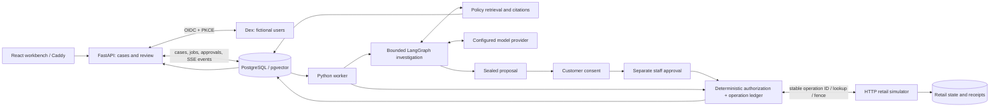

# PolicyOps

[](https://github.com/XiaoyunYin/policyops/actions/workflows/ci.yml)

PolicyOps is an AI operations workbench for investigating fictional retail support cases,
reviewing cited proposals, and approving simulated order changes.
It separates model suggestions from deterministic authorization, then uses durable operation
IDs and receipts to reconcile writes whose responses are lost.

**Status:** local showcase, verified locally including real-browser E2E on the Compose stack;
not deployed. GitHub Actions runs the offline gates on Ubuntu and Windows and the
PostgreSQL/Dex integration suites on Ubuntu, with no secrets or model calls.
The default Compose stack leaves model-driven investigation unconfigured. Its browser demo
starts from a deterministic proposal and exercises real consent, approval and simulator execution.

## Workflow

An operator opens a case. A configured, bounded investigation agent reads business facts
and policy evidence, then presents a cited proposal. The customer must consent to its exact
terms, and a separate authorized staff member must approve the sealed version. The execution
service rechecks authority, sends the write to the retail simulator, and records a receipt
or an explicit unresolved outcome.



The graph and provider composition are implemented and tested separately from the default
Compose demo. The browser flow uses staff-entered simulated customer consent; it is not
evidence of real customer consent or a model-driven browser investigation.
See [runtime composition](docs/architecture.md#investigation-graph-and-checkpoints) and
[the browser acceptance scope](docs/operations.md#real-browser-workbench-acceptance).

## Results at a glance

- **E03, registered holdout:** Luna strict pass^1 0.700 vs Haiku 0.750; difference −0.050 [−0.135, 0.035], 44% lower settled all-actor cost. Decision: `descriptive`; non-inferiority not shown. Dev v6: 0.7125 vs 0.7875. [Method and results](docs/evaluation.md#e03-model-comparison).
- **E04, recovery:** 100 paired fault cases; ledger 83 completed once + 17 fenced without effect, zero duplicate effects. Naive retry misreported all 20 committed lost-response writes as failures. Acceptance passed within this fixture scope. [Recovery study](docs/evaluation.md#e04-operation-ledger-versus-naive-retry).
- **E05, authorization:** final live sample: gateway 0/48 attack effects, prompt-only Luna 2/48; false blocks 0/12 vs 6/12. Acceptance passed; this is a controlled authority test, not general injection resistance. [Attack study](docs/evaluation.md#e05-gateway-versus-prompt-only).
- **Browser and recovery drills:** 2/2 Playwright flows passed; kill-after-commit recovered by receipt lookup without resend, and a stopped-writer separate-database restore passed. Correctness acceptance passed; no load/performance claim. [Exact scope](docs/evaluation.md#recovery-and-e07-correctness).

Intervals are paired task-bootstrap 95% intervals. E03 uses the minimal agent with the full
retail policy, not the workbench graph or a retrieval variant. Raw trajectories are not
published; the [evidence report](docs/evaluation.md) records configs, snapshot identities,
failures, spending and reproduction commands.

## Engineering decisions

| Decision | Trade-off and rejected alternative | Evidence |
|---|---|---|
| The model proposes; deterministic services authorize | More explicit rules and refusal paths; prompt-only policy enforcement cannot close expiry/revocation races | [Gateway](docs/architecture.md#policy-and-tool-gateway), [E05](docs/evaluation.md#e05-gateway-versus-prompt-only) |
| Consent and staff approval bind immutable versions and digests | Changes require a fresh decision; a generic approval flag cannot bind arguments, evidence, terms and expiry | [Review contracts](docs/architecture.md#proposal-review-t18), [race tests](tests/integration/test_proposal_decisions.py) |
| Stable operation IDs, a ledger and reconciliation | Ambiguous writes may remain unknown or be fenced without effect; checkpoint replay or blind retry cannot establish a remote outcome | [Execution](docs/architecture.md#approved-execution-and-reconciliation-t19), [E04](docs/evaluation.md#e04-operation-ledger-versus-naive-retry) |
| Forced RLS with separate migration/runtime roles | More grants and transaction scope management; application filters alone leave query mistakes exposed | [Database roles](docs/database.md#roles), [runtime-role tests](tests/integration/test_app_tenancy.py) |
| Reserve worst-case cost and retain unknown bills | Conservative holds reduce availability; estimating a missing bill as zero would permit unaccounted spending | [Budget ledger](docs/architecture.md#model-configuration-and-usage-budgets), [accounting tests](tests/integration/test_budget_ledger.py) |
| Prespecified dev studies, registered holdout, strict pass^k | Errors remain failures in headline metrics; dropping errored trials or changing gates after results would bias selection | [Evaluation method](docs/evaluation.md#method), [statistics](evals/src/policyops_evals/studies/statistics.py) |
| PostgreSQL jobs and a tenant-bound JSON checkpointer | Fewer services, explicit fencing and serializer maintenance; Redis/Celery and unrestricted object checkpoints add dependencies or authority | [Runtime](docs/architecture.md#investigation-graph-and-checkpoints), [checkpoint tests](tests/integration/test_checkpoints.py) |

## Stack

- **Backend:** Python 3.12, FastAPI, Pydantic, SQLAlchemy, Alembic, psycopg;
  LangGraph investigation with a custom PostgreSQL checkpointer.
- **Persistence:** PostgreSQL 17, pgvector, full-text search, immutable evidence versions,
  leased jobs, transactional outbox, execution and usage ledgers.
- **Web:** React, strict TypeScript, Vite, React Router, React Aria Components;
  generated OpenAPI types and fetch-based SSE replay.
- **Identity and operations:** OIDC authorization code + PKCE, server-side sessions,
  Dex, Caddy, Docker Compose, opt-in OpenTelemetry and allowlisted JSON logging.
- **Evaluation:** separately locked τ²-bench runtime, bounded OpenAI/Anthropic SDK adapters,
  pytest, Vitest and Playwright. Default tests use fake providers and block network access.

Exact versions are in [the app lock](uv.lock), [the evaluator lock](evals/uv.lock),
[the web lock](apps/web/package-lock.json) and [image pins](infra/images.json).

## Quickstart

Use Git, a helper Python interpreter (3.10+), uv 0.13.x (verified with 0.13.7),
Node 26.13.0 and Docker with Linux amd64 containers and Compose 2.24+.
Dependency installation, tokenizer provisioning and image builds need network access;
the checks below run offline after provisioning. Commands start at the repository root.

Set a process-local scratch directory outside the checkout. On Linux use equivalent
exports, set `TMPDIR` too, and use `venvs/app/bin/python`.

```powershell
$env:POLICYOPS_TEMP_DIR = 'D:\path\outside\checkout\policyops-tmp'
$env:TEMP = "$env:POLICYOPS_TEMP_DIR/tmp"
$env:TMP = $env:TEMP
$env:PYTHONDONTWRITEBYTECODE = '1'
New-Item -ItemType Directory -Force $env:TEMP | Out-Null
python -B scripts/devenv.py uv sync --frozen
python -B scripts/devenv.py uv sync --project evals --frozen
python -B scripts/fetch_tokenizer_vocab.py
Push-Location apps/web
python -B ../../scripts/devenv.py npm ci
Pop-Location
```

Start the local stack with fresh external secrets:

```powershell
$env:POLICYOPS_PYTHON = "$env:POLICYOPS_TEMP_DIR/venvs/app/Scripts/python.exe"
$env:COMPOSE_PROJECT_NAME = 'policyops-demo'
$env:POLICYOPS_RUN_ID = 'demo-choose-a-fresh-unique-id'
$env:POLICYOPS_SECRETS_DIR = "$env:POLICYOPS_TEMP_DIR/compose/$env:POLICYOPS_RUN_ID/secrets"
$env:POLICYOPS_HTTP_PORT = '8080'
& $env:POLICYOPS_PYTHON -B scripts/compose_secrets.py
python -B scripts/check_build_context.py --context .
docker compose build
docker compose up -d
docker compose ps --all
```

Open **http://127.0.0.1:8080**. Fictional analyst Alice, reviewer Bob and auditor Carol
use the generated password files; do not copy them into logs. Startup runs separate app
and retail migrations. Follow [operations](docs/operations.md#start-and-stop) for sign-in
fixtures, the [browser scenario](docs/operations.md#real-browser-workbench-acceptance),
stopping, reuse of secrets and safe disposal of a selected demo volume.
A fresh run returns `runtime.unconfigured` until a model runtime is explicitly composed.

Run offline checks with installed dependencies and cached tokenizer/scanner assets:

```powershell
python -B scripts/devenv.py uv run --offline --frozen ruff check .
python -B scripts/devenv.py uv run --offline --frozen mypy
python -B scripts/devenv.py uv run --offline --frozen pytest
Push-Location evals
python -B ../scripts/devenv.py uv run --offline --frozen mypy
python -B ../scripts/devenv.py uv run --offline --frozen pytest
Pop-Location
Push-Location apps/web
python -B ../../scripts/devenv.py npm --offline run lint
python -B ../../scripts/devenv.py npm --offline run typecheck
python -B ../../scripts/devenv.py npm --offline test
Pop-Location
python -B scripts/check_publication.py
```

PostgreSQL integration and real-browser suites are separate and require local services.
[Development and harness reference](docs/operations.md#development-setup) includes both
environments, generated API contracts, test guards, publication hooks and CI definitions.
No paid evaluation or provider call is part of these default commands.

## Live demo / Deploy

Live URL: **pending deployment and HTTPS/rollback verification**. The offline AWS
[deployment runbook](docs/deployment.md) provisions a $12/month Lightsail demo with
Terraform, Caddy TLS and a $20 budget alert. Public fictional credentials and their
restricted demo roles are documented there. No provider keys or real customer data
belong on this host; nightly resets discard demo activity.

## Repository map

| Path | Purpose |
|---|---|
| [`packages/policyops/`](packages/policyops/) | API, domain rules, services, gateway, runtime, providers, persistence and telemetry |
| [`packages/policyops_contracts/`](packages/policyops_contracts/) | Strict wire schemas, tool catalog, policy traceability and exact money |
| [`apps/web/`](apps/web/) | Case queue, evidence/activity views, approval inbox and outcome cards |
| [`evals/`](evals/) | Pinned benchmark adapter, metadata manifests, study configs, reports and retail simulator |
| [`tests/`](tests/) | Offline, PostgreSQL, authorization, recovery and tooling regressions |
| [`infra/`](infra/) | Compose images, runtime composition, migrations/seed wiring, Dex and Caddy |
| [`scripts/`](scripts/) | Local environments, safety studies, scans and deployment/recovery drivers |
| [`.github/workflows/`](.github/workflows/) | Ubuntu/Windows offline gates and explicit PostgreSQL job |

## Limits and remaining work

- No production deployment, real customers or real commerce mutations. External hosting
  needs TLS/issuer/secret settings, ingress/egress hardening and rollback verification.
- E03 does not show Luna quality-equivalent to Haiku. Its reference errors and held bill
  remain reported; costs are local ledger calculations, not reconciled provider invoices.
- Banking trajectory retrieval (E01) is outside this release: ingestion, search, reranking
  and offline metric machinery exist, but its study controller/evaluator contract and
  quality results do not. Retail E03 uses full policy context.
- No ANN/HNSW scaling study, graph-versus-loop quality comparison, context/cache optimization
  study, evaluation explorer or collector/dashboard stack.
- No hard end-to-end deadline guarantee: synchronous SQL, in-flight remote calls and
  connection shutdown have documented limits. No billing-evidence outbox exists.
- Citations verify historical source identity and exact quotes, not entailment or truth.
  The recovery drills cover one host and a stopped-writer same-cluster logical restore,
  not host loss, PITR or every crash window. Broader screen-reader review remains open.
- Known dependency advisories and scan limitations are recorded in
  [security](docs/security.md#residual-risks-and-explicit-exclusions).

## Documentation and license

[Architecture and API contracts](docs/architecture.md) ·
[Evaluation and results](docs/evaluation.md) ·
[Local operations and development](docs/operations.md) ·
[Database and restore](docs/database.md) ·
[Authentication](docs/authentication.md) ·
[Security and tests](docs/security.md) ·
[Data provenance](docs/data-provenance.md).

PolicyOps is [MIT licensed](LICENSE). Bulk benchmark data, task payloads and document text
are fetched outside the checkout, not committed. The simulator image includes the audited
retail fixture and upstream license; the root upstream MIT grant does not establish every
data file's provenance. See [third-party notices](THIRD_PARTY_NOTICES.md).
